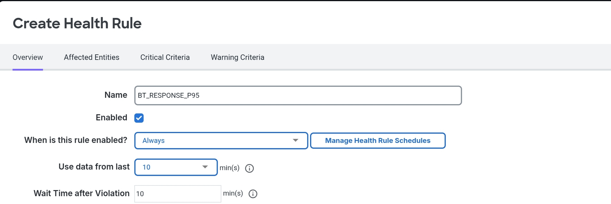
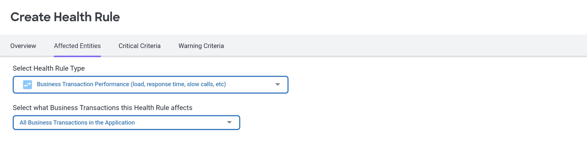
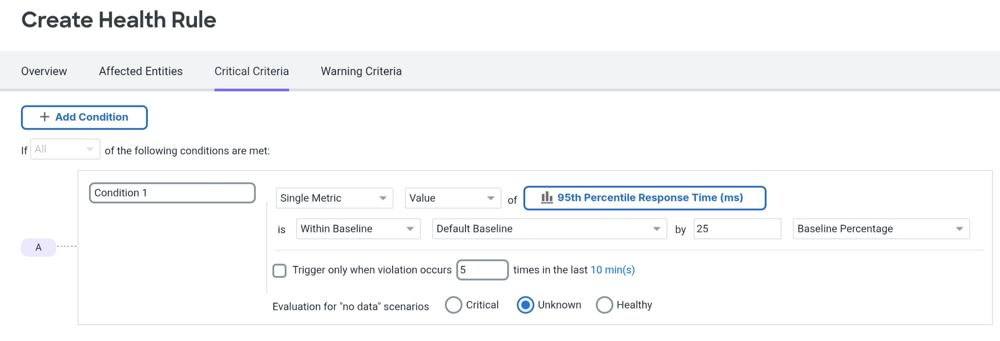
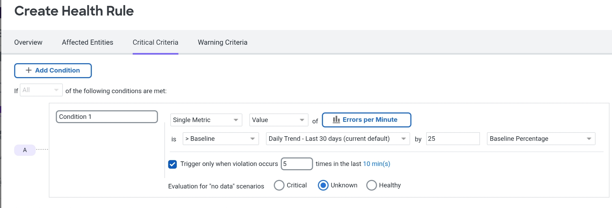
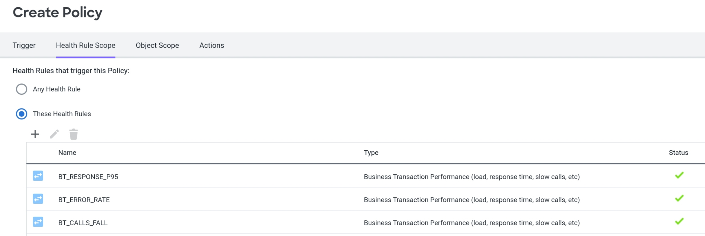

# Alertes AppDynamics : Health Rules et Policies

Guide pratique pour **AppDynamics Controller on-premises 23.x**. Les seuils ci-dessous sont des exemples à calibrer selon le trafic, les horaires et les objectifs de service.

## Comprendre le circuit d'alerte

| Élément | Rôle | Exemple |
|:--|:--|:--|
| Métrique | Mesure remontée par un agent | Temps de réponse moyen d'une Business Transaction (BT) |
| Health Rule | Définit le périmètre, les conditions et les niveaux Warning/Critical | Réponse au-dessus d'une baseline |
| Violation | Événement créé lorsque la règle est enfreinte | `Health Rule Violation Started - Critical` |
| Policy | Sélectionne l'événement et l'action | Courriel à l'astreinte |

Une Health Rule peut signaler une violation sans envoyer de message : la notification dépend d'une Policy et d'une action associée. [Documentation Health Rules](https://docs.appdynamics.com/appd/onprem/23.x/latest/en/appdynamics-essentials/alert-and-respond/health-rules).

## Baseline, P95 et persistance

Une **baseline dynamique** décrit le comportement habituel d'une *métrique choisie*. Une condition peut comparer cette métrique à sa baseline quotidienne ou hebdomadaire avec un pourcentage ou un nombre d'écarts types. Le **P95**, lui, est un percentile : 95 % des observations sont inférieures ou égales à sa valeur. Une baseline n'est donc pas automatiquement un P95. Pour alerter sur un percentile, choisir et vérifier explicitement cette métrique dans le Controller ; ne pas mélanger moyenne et P95 dans la même formule. [Documentation des conditions](https://docs.appdynamics.com/appd/onprem/23.x/23.11/en/appdynamics-essentials/alert-and-respond/health-rules/health-rule-conditions).

La baseline **Daily Trend** compare des périodes horaires comparables. Elle ne signifie pas simplement « les sept derniers jours ». Vérifier l'historique et le volume de mesures avant de l'utiliser. [Documentation des baselines](https://docs.appdynamics.com/display/PRMY23/.Dynamic%2BBaselines%2Bv23.9).

### Exemple : Login trop lent

**Hypothèse illustrative** : la baseline Daily Trend du *temps de réponse moyen* de la BT `Login` vaut **1 100 ms** à 10 h. Avec un écart de **+25 %**, le seuil vaut **1 375 ms** (`1 100 × 1,25`).

| Réglage | Valeur d'exemple |
|:--|:--|
| Type et scope | Business Transaction, BT `Login` |
| Condition Critical | Temps de réponse moyen > baseline Daily Trend de 25 % |
| Fenêtre | `Use data from last 5 min(s)` |
| Persistance | `Trigger only when violation occurs 5 times in the last 5 min(s)` |
| Garde-fou | Condition de charge minimale si le faible trafic crée du bruit |

**5 fois sur 5 minutes** porte sur les points de mesure de la fenêtre ; ce n'est pas un chronomètre déclenché au premier dépassement. Avec **3 fois sur 5 minutes**, les dépassements n'ont pas besoin d'être consécutifs. Le moment exact de l'événement dépend de l'évaluation et des données disponibles. Une persistance ne se configure que pour une fenêtre de **30 minutes ou moins**. [Documentation des seuils de persistance](https://docs.appdynamics.com/appd/onprem/23.x/23.11/en/appdynamics-essentials/alert-and-respond/health-rules/health-rule-conditions).

Une seule requête lente peut faire bondir la moyenne ou le taux d'erreur d'une BT peu sollicitée. Ajouter si besoin un minimum d'appels/minute ; pour une BT normalement très rapide, combiner la baseline avec un seuil absolu. [Documentation on-premises](https://docs.appdynamics.com/appd/onprem/23.x/latest/en/appdynamics-essentials/alert-and-respond/health-rules).

## Créer une Health Rule

1. Dans **Alert & Respond → Health Rules**, choisir l'application et le type adapté : BT, Tier/Node ou Server.
2. Définir le **scope** exact : BT, tier, nœud ou groupe de serveurs. Une règle ciblant une erreur précise ne doit pas englober toutes les BT sans intention.
3. Configurer séparément **Warning** et **Critical**. Contrôler le chemin de la métrique, l'unité, l'agrégation et les opérateurs `ANY`, `ALL` ou l'expression personnalisée.
4. Choisir `Use data from last`, la persistance si utile et `Wait Time after Violation`. Ce dernier règle la fréquence des événements *Continues*, pas le délai de la première alerte.
5. Examiner l'historique avec **Alert Sensitivity Tuning** lorsque le type de règle et son mode d'évaluation le permettent.

[Créer une Health Rule](https://docs.appdynamics.com/appd/23.x/latest/en/appdynamics-essentials/alert-and-respond/configure-health-rules/create-a-health-rule) · [Configurer les conditions](https://docs.appdynamics.com/appd/23.x/latest/en/appdynamics-essentials/alert-and-respond/configure-health-rules/create-and-configure-conditions) · [Wait Time](https://docs.appdynamics.com/display/PRMY23/Health%2BRule%2BSchedules)

### Catalogue de départ

| Règle | Condition indicative | À vérifier avant activation |
|:--|:--|:--|
| `BT_LOGIN_LATENCY_CRITICAL` | BT `Login`, temps moyen > baseline +25 %, 5/5 min | Volume d'appels, baseline et seuil absolu |
| `BT_ERRORS_CRITICAL` | Taux d'erreur >5 % **et** nombre d'erreurs significatif, 5/10 min | Définition des erreurs et dénominateur |
| `JVM_HEAP_USED_WARNING` | Heap >85 % sur une fenêtre adaptée | Évolution après GC et Xmx |
| `INFRA_CPU_HIGH_WARNING` | CPU >85 % pendant plusieurs mesures | Charge normale, agent et licence |
| `DB_RESPONSE_CRITICAL` | Temps DB > baseline ou seuil fixe | Backend affecté et nombre d'appels |

Ces seuils ne sont **pas des valeurs par défaut AppDynamics**. Une erreur HTTP 5xx, une exception Java et une erreur de BT ne sont pas nécessairement équivalentes : confirmer ce que remonte l'agent.

### Absence de données et disponibilité

Une métrique absente peut produire l'état **Unknown**. L'option `Evaluate to true on no data` change ce comportement ; la documentation recommande de la **désactiver pour les métriques de disponibilité**. L'absence de trafic d'une BT ne démontre pas à elle seule que l'application est indisponible. Distinguer heures creuses, agent arrêté et service inaccessible ; compléter au besoin par un contrôle actif de l'endpoint. [Conditions et données manquantes](https://docs.appdynamics.com/appd/onprem/23.x/23.11/en/appdynamics-essentials/alert-and-respond/health-rules/health-rule-conditions).

Pour CPU, mémoire et processus, vérifier que le **Machine Agent** et les fonctions de visibilité requises remontent les données. Copier le chemin exact depuis le **Metric Browser** de votre Controller. [Documentation Machine Agents](https://docs.appdynamics.com/appd/23.x/latest/en/application-monitoring/install-app-server-agents/machine-agents).

## Configurer la Policy

1. Sélectionner l'application, l'environnement et les Health Rules concernées.
2. Pour une première notification, choisir **Health Rule Violation Started - Critical**, et éventuellement **Started - Warning**.
3. Activer **Health Rule Violation Continues** uniquement pour un rappel utile. Régler `Wait Time after Violation` pour éviter les notifications répétées.
4. Associer les actions au bon niveau : courriel, webhook ou outil d'incident. Inclure application, entité, règle, sévérité et lien vers la violation.
5. Tester réception, retour à la normale et horaires de notification avec l'astreinte.

Les événements *Started* et *Continues* sont distincts ; il n'est pas nécessaire d'activer systématiquement les deux. [Health Rule Schedules](https://docs.appdynamics.com/display/PRMY23/Health%2BRule%2BSchedules) · [Events Reference](https://docs.appdynamics.com/appd/23.x/23.1/en/appdynamics-essentials/monitor-events/events-reference).

### Nommage conseillé

```text
Health Rule : <DOMAINE>_<METRIQUE>_<SEVERITE>
Exemple     : BT_LOGIN_LATENCY_CRITICAL

Policy      : POL_<ENV>_<DOMAINE>_<SEVERITE>
Exemple     : POL_PROD_BT_CRITICAL
```

Documenter le propriétaire, le scope, la justification du seuil et le runbook dans la description. Vérifier la cohérence des niveaux Warning et Critical.

## Diagnostiquer une alerte

| Symptôme | Contrôles |
|:--|:--|
| Pas de violation | Scope, métrique, unité, trafic, fenêtre, persistance et données manquantes |
| Violation sans notification | Policy activée, événement *Started*, filtres, action et destinataire |
| Rappels trop nombreux | Événement *Continues* et `Wait Time after Violation` |
| Règle grise ou inconnue | Agent, fraîcheur des métriques et traitement de l'absence de données |
| Faux positifs | Seuil absolu, charge minimale, baseline et horaires de service |

Tester d'abord sur une règle maîtrisée, puis ajuster selon les événements réellement produits. Un **Transaction Snapshot** ou la **Flow Map** peut aider au diagnostic si les données correspondantes ont été capturées ; leur création n'est pas garantie par la seule violation de la Health Rule.


### Captures de configuration









### Références complémentaires

- [Health Rule API — AppDynamics 23.x](https://docs.appdynamics.com/appd/23.x/latest/en/extend-appdynamics/appdynamics-apis/alert-and-respond-api/health-rule-api)
- [Dépannage Alert and Respond — AppDynamics 23.x](https://docs.appdynamics.com/appd/23.x/latest/en/appdynamics-essentials/alert-and-respond/troubleshoot-alert-and-respond-problems)
