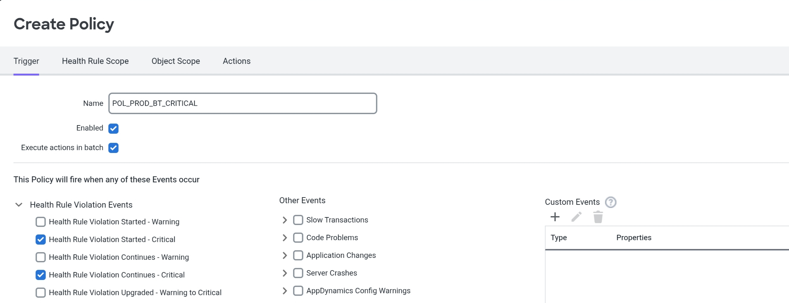
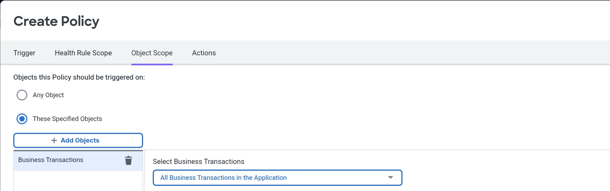
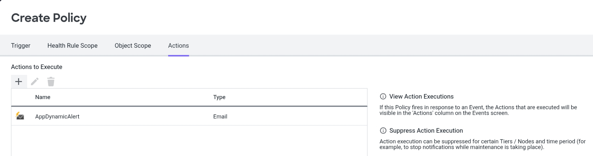

## Concepts
### Health Rules
definit les regles qui declenchent une alerte

### Policy
Quand et comment Notifier en cas d'alerte.

### Baseline  (historique P95)
La baseline definit comportement normal d’un élément (BT, serveur, DB, service…) calculé automatiquement par AppDynamics sur un historique récent (jours ou semaines).,

### P95, 95 Percentile
Exemple: 95 % des transactions sont plus rapides que cette valeur. les 5% plusvlentes seront ignorées. P95 est calculé par tranche de temps

### Durée de persistence
le temps continu pendant lequel la condition anormale est vraie, au dessus duquel l'alerte sera déclechée.

### Exemple
- Application : Espace personnel  en ligne
- Business Transaction : Login utilisateur
- Métrique surveillée : Temps de réponse (ms)
- Type de baseline : Daily Trend
- Déviation : +25 %
- Durée de persistance : 5 minutes

📊 Baseline calculée par AppDynamics

AppDynamics observe les 7 derniers jours et calcule :

| Heure  | Baseline (P95) |
|:-------|:--------------:|
|08h–09h|900 ms |
|09h–12h|1100 ms|
|12h–14h|1300 ms|
|14h–18h|1000 ms|
|18h–22h|800 ms |

👉 À 10h, la baseline est 1100 ms.

⚙️ Seuil dynamique

Déviation configurée : +25 %

Seuil = 1100 ms × 1,25 = 1375 ms

⏱️ Ce qui se passe réellement (timeline)
Scénario réel observé

|Heure | Temps réel login| État |
|:-----|:----------------|:----:|
|10:00 | 1 450 ms | ❌ au-dessus|
|10:01 | 1 500 ms | ❌ au-dessus|
|10:02 | 1 480 ms | ❌ au-dessus|
|10:03 | 1 420 ms | ❌ au-dessus|
|10:04 | 1 410 ms |❌ au-dessus|
|10:05 | 1 410 ms |❌ au-dessus|

🚨 Déclenchement de l’alerte : 6 minutes consécutives au-dessus du seuil
- ALERTE CRITIQUE déclenchée à 10h05
- Snapshot automatique
- Flow Map montre :
  - Service d’authentification lent
  - Requête SQL lente

## Création des alertes
**HR - Heath Rules**
- Il  faut définir le **scope** au niveau du HR aussi pour definir sur quels objets la règle s'applique, notamment pour le HR_ERREUR où il faut définir quelle erreur la HR s'applique (Erreur 500, 401, SSLHandshake etc)

**Policy**
- Toujours activer:
  - Health rule violation startted
  - Health rule violation continues

### Common rules
Créer des templates: 
- CPU_Hot (Nodes): Hardware Resources|CPU|%Busy > 85% for 5 of 5 min (Critical), > 75% (Warning)
- Memory_Pressure: Hardware Resources|Memory|%Used > 90% for 10 of 10 min.
- BT_Slow: Average Response Time > baseline + 3σ, min load ≥ 30 cpm, for 5 of 10 min.
- BT_Errors: 
-- Scope: Business Transactions → All BTs in your application
-- Critical: Error% > 5% AND Errors/min > 10, for 5 of 10 min
-- Warning: Error % > 2%
-- Re-arm: 10 minutes

### Regles de nomages
1. Health Rules : **DOMAIN_METRIC_SEVERITY**
   - DOMAIN : BT, JVM, DB, REMOTE_SERVICE, INFRA, CUSTOM
   - METRIC: 
     - BT: RESPONSE_P95(Percentile 95), ERROR_RATE, ERROR_COUNT, STALL
     - JVM:  HEAP_USED, GC_TIME, GC_Frequence, THREAD_BLOCKED, CPU
     - DB:  ERROR_RATE, RESP_P95, ACTIVE_CONN
     - REMOTE SERVICE: ERROR_RATE, RESP_P95, ERROR_RATE
   - SEVERITY: CRITICAL, WARN
   - Exemple: JVM_HEAP_USED_CRITICAL
   
2. Policies: **POL_ENV_DOMAIN_SEVIRITY**
   - ENV: PROD, PREPROD
   - Exemple: POL_PROD_BT_CRITICAL

Voir ce [lien](https://community.splunk.com/t5/AppDynamics-Knowledge-Base/For-Health-Rules-what-naming-conventions-are-recommended/ta-p/729452)

### Performance des Business Transactions - BT
- BT_TempsRéponse_Lent: 
  -- Temps de réponse moyen d'une transaction > 2s OU
  -- BT login, P95 historique à 10h = 1 100 ms
  -- Déviation = +25 % → seuil = 1 375 ms
  -- Durée de persistance = 5 min
  -- Si login > 1 375 ms pendant 5 minutes consécutives → alerte déclenchée.
- BT_TempsRéponse_TrèsLent: Temps de réponse 95e percentile > 4s  
- BT_Trafic_Chute_Soudaine: Diminution brutale du nombre d'appels d'une transaction  
- BT_Taux_Lenteur_Augmenté: % de transactions lentes > 10% du total  

### Erreurs et Exceptions
- Erreur_HTTP_5xx_Elevée: Taux d’erreurs HTTP 5xx > 2%  
- Erreur_JAVA_Exception_Non_Gérée: Augmentation du nombre d’exceptions JVM non gérées  
- Erreur_API_Externe: Erreurs sur appel d’un service externe (ex: API REST)  

### Disponibilité de l’Application
  - App_Inactive_AucuneRequête: Aucune requête reçue sur l’application depuis X minutes  
  - App_JVM_HS: JVM ne répond plus ou redémarrage détecté. L'Agent est down.
    - health rule of type **Tier / Node Health - Hardware** affect **Nodes** and test for metric **Agent/App/Availability** < 1.
    - Use data from last **5 min**. must be short!
  - App_ServiceIndisponible_Endpoint: Un endpoint critique ne répond pas (ex: /health ou /actuator/health)  
  - Alert on Missing Linux Process: 
    - with machine Agent: Health Rule Type **Custom** on **Servers** and setup condition **Individual Nodes/vm1/Hardware Resources/Process/<process-name>|Count**
    - with [process-monitoring-extension] (https://www.appdynamics.com/community/exchange/extension/process-monitoring-extension/). ??

### Infrastructure
 - INFRA_MACHINE_AGENT_HS
    - Use data from last: 5min
    - Wait Time after violation : 5 min
    - Health rule type: Server Health
    - Condition : *Hardware Resource/Machine/Availability* < 1
  - INFRA_CPU_HIGH
    - Health rule type: Server Health
    - Condition : *Hardware Resource/CPU/%Bubsy* > 85
  
  - INFRA_USED_MEMORY_HIGH
    - Health rule type: Server Health
    - Condition : *Hardware Resource/Memory/%Used* > 75

### Server Monitoring
Installer Machine Agent.
- Machine Agent Down Alert: [Note Pratique](https://www.cisco.com/c/en/us/support/docs/quality-of-service-qos/qos-configuration-monitoring/223191-prevent-outages-with-agent-availability.html). Check every 5minutes!

### Ressources JVM
- JVM_Heap_Memory_Saturé: Heap utilisé > 85%  
- JVM_FullGC_Frequence_Elevée: Nombre de Full GC > 5/min  
- JVM_CPU_Taux_Elevé: CPU > 90%  
- JVM_Threads_Bloqués: Threads bloqués > seuil critique  

###  Appels Externes et Backend
- DB_TempsRéponse_Lent: Temps de réponse d’une requête DB > 1s  
- DB_Erreurs_Fréquentes: Taux d’erreurs DB > 2%  
- API_Tiers_Réponse_Lente: Service externe REST prend > 2s pour répondre  
- API_Tiers_Erreurs_Répétées: Appels échoués vers un service externe > 3/min  

### Métriques personnalisées Spring Boot (via Actuator)
- Actuator_Latence_File_Message: Latence de traitement d'une file Kafka ou RabbitMQ > seuil  
- Actuator_UtilisateursActifs_Baisse: Nombre d'utilisateurs actifs < seuil  
- Actuator_TauxConversion_Baisse: KPI métier : taux de conversion chute  

### Notification & Automatisation
- Notif_Email_Incident_Critique: Déclenchement de notification email en cas d'incident critique  
- Notif_Slack_Warning_App: Alerte envoyée vers Slack pour incident moyen  
- Notif_PagerDuty_Downtime: Incident critique déclenche intervention via PagerDuty

[Voir ce lien](https://docs.appdynamics.com/appd/23.x/latest/en/application-monitoring/overview-of-application-monitoring)

### KPI - Key Performance Indicators
- Response Time**: Temps pris pour répondre aux requêtes des utilisateurs.
- Throughput**: nombre de requêtes  exécutées  pendant un intervalle de temps.
- Error Rates**: pourcentage des requêtes  en erreur.
- Transaction Times**: temps d'exécution de transaction.

### Scheduler
- Controller evaluate the status of the health rules every minute. 

### Alert Sensitivity Tuning (AST). 
AST helps you visualize the impact of the alerting configuration as and when you configure. 

### Status d'une règle 
si le contrôleur n'arrive pas à évaluer une règle,  par exemple dans le cas d'un nœud qui arrête de rapporter, il la marque en gris avec un point d'interrogation

### Exemples

### Favoris
- [Health Rule Api](https://docs.appdynamics.com/appd/23.x/latest/en/extend-appdynamics/appdynamics-apis/alert-and-respond-api/health-rule-api)

-  [Alert and Rule Doc](https://docs.appdynamics.com/appd/23.x/23.12/en/appdynamics-essentials/alert-and-respond/health-rules)