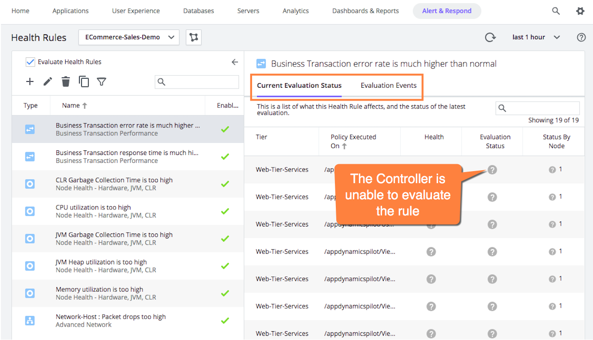

# Alertes AppDynamics — notes de production

**Controller on-premises 23.x.** Seuils ci-dessous = exemples à ajuster avec les métriques réelles et le trafic de l'application.

## Rappels rapides

- **Health Rule (HR)** : scope + métrique + condition Warning/Critical + fenêtre d'évaluation.
- **Policy** : événement de violation + action (mail, webhook, outil d'incident).
- **Started** : première notification. **Continues** : rappel facultatif, cadencé par `Wait Time after Violation`. Ne pas activer tous les rappels sans besoin.
- **Persistance 5/10 min** : dépassement sur 5 points dans une fenêtre de 10 min, pas forcément 5 minutes consécutives.
- **Baseline** : comportement habituel d'une métrique. **P95** : percentile d'une distribution. Une baseline n'est pas automatiquement le P95.
- **Scope** : cibler les BT, tiers, nœuds ou serveurs utiles. Pour une erreur précise (HTTP 500, 401, SSLHandshake), vérifier que l'agent expose bien la métrique ou l'événement correspondant.

[Health Rules](https://docs.appdynamics.com/appd/onprem/23.x/latest/en/appdynamics-essentials/alert-and-respond/health-rules) · [Conditions et persistance](https://docs.appdynamics.com/appd/onprem/23.x/23.11/en/appdynamics-essentials/alert-and-respond/health-rules/health-rule-conditions) · [Wait Time](https://docs.appdynamics.com/display/PRMY23/Health%2BRule%2BSchedules)

## Règles à conserver

### Business Transactions

| Alerte | Condition de départ |
|:--|:--|
| `BT_Slow` / `BT_TempsRéponse_Lent` | Temps de réponse moyen > baseline +3σ, charge ≥30 appels/min, 5/10 min ; ou seuil fixe >2 s selon la BT. |
| `BT_TempsRéponse_TrèsLent` | P95 >4 s, **si cette métrique est disponible** dans le Controller. |
| `BT_Trafic_Chute_Soudaine` | Baisse anormale du nombre d'appels d'une BT normalement active ; limiter aux plages de service. |
| `BT_Taux_Lenteur_Augmenté` | Transactions lentes >10 % du total, avec un volume minimal. |
| `BT_Errors` | Warning : erreurs >2 %. Critical : erreurs >5 % **et** >10 erreurs/min, 5/10 min. Rappel éventuel après 10 min. |

**Exemple Login** : si la baseline du *temps moyen* à 10 h vaut 1 100 ms, une déviation de +25 % donne un seuil de **1 375 ms**. Choisir `5 fois sur 5 min` si chaque point de la fenêtre doit dépasser le seuil. Ne pas appeler cette baseline « P95 » sans avoir sélectionné la métrique P95. Avec peu d'appels, ajouter un minimum de charge et éventuellement un seuil absolu.

### Erreurs et exceptions

| Alerte | Condition de départ |
|:--|:--|
| `Erreur_HTTP_5xx_Elevée` | HTTP 5xx >2 % ; vérifier le nombre d'appels et la métrique réellement collectée. |
| `Erreur_JAVA_Exception_Non_Gérée` | Augmentation des exceptions non gérées ; filtrer la classe ou le type si possible. |
| `Erreur_API_Externe` | Erreurs répétées sur un appel REST/service externe ; isoler le backend concerné. |

Une erreur HTTP, une exception Java et une erreur de BT ne sont pas forcément la même mesure.

### Disponibilité et processus

| Alerte | Condition de départ |
|:--|:--|
| `App_Inactive_AucuneRequête` | Aucune requête sur une BT normalement active pendant X min ; exclure les heures creuses. |
| `App_JVM_HS` | Agent/nœud indisponible ou redémarrage suspect ; vérifier `Agent/App/Availability` dans le Metric Browser. L'absence d'agent ne prouve pas seule que la JVM est arrêtée. |
| `App_ServiceIndisponible_Endpoint` | Échec de `/health` ou `/actuator/health` ; nécessite un contrôle actif adapté si l'endpoint n'est pas instrumenté. |
| `Linux_Process_Missing` | Processus absent via Machine Agent/extension ; chemin `Hardware Resources/Process/<process-name>|Count` à confirmer localement. |
| `INFRA_MACHINE_AGENT_HS` | Disponibilité Machine Agent <1 ; fenêtre courte, par exemple 5 min, et rappels maîtrisés. |

Pour les métriques absentes, examiner le statut **Unknown** et le réglage `Evaluate to true on no data` ; la documentation recommande de le désactiver pour les métriques de disponibilité. [Détails](https://docs.appdynamics.com/appd/onprem/23.x/23.11/en/appdynamics-essentials/alert-and-respond/health-rules/health-rule-conditions).

### Infrastructure et JVM

| Alerte | Condition de départ |
|:--|:--|
| `CPU_Hot` / `INFRA_CPU_HIGH` | CPU >75 % Warning, >85 % Critical, par exemple 5/5 min. |
| `Memory_Pressure` / `INFRA_USED_MEMORY_HIGH` | Mémoire >75 % Warning, >90 % Critical ; vérifier mémoire disponible et pression réelle. |
| `JVM_Heap_Memory_Saturé` | Heap >85 % ; observer la valeur **après GC** et sa tendance. |
| `JVM_FullGC_Frequence_Elevée` | Full GC >5/min (exemple) ; vérifier durée des pauses et impact. |
| `JVM_CPU_Taux_Elevé` | CPU JVM >90 % de façon persistante. |
| `JVM_Threads_Bloqués` | Nombre de threads bloqués au-dessus d'un seuil défini pour l'application. |

**Server Monitoring** : installer/configurer le Machine Agent et vérifier les droits/licences de visibilité serveur avant de créer des HR Server Health. Confirmer les chemins et unités dans le Metric Browser. [Machine Agents](https://docs.appdynamics.com/appd/23.x/latest/en/application-monitoring/install-app-server-agents/machine-agents).

### Base de données et services externes

| Alerte | Condition de départ |
|:--|:--|
| `DB_TempsRéponse_Lent` | Appel DB >1 s ou >baseline, avec volume minimal. |
| `DB_Erreurs_Fréquentes` | Erreurs DB >2 % ; identifier la base et le type d'erreur. |
| `API_Tiers_Réponse_Lente` | Service REST externe >2 s ; cibler le service. |
| `API_Tiers_Erreurs_Répétées` | Plus de 3 échecs/min vers le même service (exemple). |

### Métriques personnalisées Spring Boot

| Alerte | Condition de départ |
|:--|:--|
| `Actuator_Latence_File_Message` | Latence de traitement Kafka/RabbitMQ >seuil. |
| `Actuator_UtilisateursActifs_Baisse` | Utilisateurs actifs <seuil pendant une plage pertinente. |
| `Actuator_TauxConversion_Baisse` | KPI métier en baisse par rapport à la référence. |

**À vérifier** : une métrique Actuator n'est pas automatiquement une métrique AppDynamics. Prévoir sa collecte par une extension ou une intégration et contrôler son chemin dans le Metric Browser.

## Policy et nommage

- Pour une notification initiale : `Health Rule Violation Started - Critical` ; ajouter Warning selon l'astreinte.
- Pour les rappels : `Health Rule Violation Continues` uniquement si nécessaire ; régler `Wait Time after Violation`.
- Actions à conserver : `Notif_Email_Incident_Critique`, `Notif_Slack_Warning_App`, `Notif_PagerDuty_Downtime`. Ce sont des **actions de Policy**, pas des métriques ni des Health Rules.
- Nom HR : `DOMAINE_METRIQUE_SEVERITE` (ex. `JVM_HEAP_USED_CRITICAL`).
- Nom Policy : `POL_ENV_DOMAINE_SEVERITE` (ex. `POL_PROD_BT_CRITICAL`).
- Dans la description : application, scope, seuil, propriétaire et lien vers le runbook.

## Vérification rapide

| Symptôme | Contrôler |
|:--|:--|
| Règle grise / inconnue | Agent, arrivée des métriques, fenêtre et absence de données. |
| Violation sans mail | Policy activée, événement *Started*, filtre, action et destinataire. |
| Trop d'alertes | Scope, charge minimale, seuil, persistance, événements *Continues*. |
| Pas de violation | Chemin de métrique, unité, trafic, opérateur et fenêtre. |

Un Transaction Snapshot ou une Flow Map aide au diagnostic **si les données ont été capturées** ; la HR seule ne garantit pas leur création. [Dépannage officiel](https://docs.appdynamics.com/appd/23.x/latest/en/appdynamics-essentials/alert-and-respond/troubleshoot-alert-and-respond-problems).

**Mes captures** : [HR 1](/docs/images/appdynamics/Appdynamics-HR-1.jpg) · [HR 2](/docs/images/appdynamics/Appdynamics-HR-2.jpg) · [HR 3](/docs/images/appdynamics/Appdynamics-HR-3.jpg) · [HR 4](/docs/images/appdynamics/Appdynamics-HR-4.jpg) · [Policy 1](/docs/images/appdynamics/Appdynamics-POL-1.jpg) · [Policy 2](/docs/images/appdynamics/Appdynamics-POL-2.jpg) · [Policy 3](/docs/images/appdynamics/Appdynamics-POL-3.jpg) · [Policy 4](/docs/images/appdynamics/Appdynamics-POL-4.jpg)

[API Health Rules](https://docs.appdynamics.com/appd/23.x/latest/en/extend-appdynamics/appdynamics-apis/alert-and-respond-api/health-rule-api)
