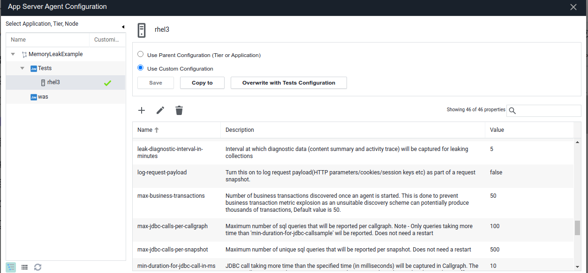

## Java Agent
-------------------------------------------------
- Download and Unzip the Java Appserver Agent

- The user under which the JVM runs must have write privileges to the **conf** and **logs** directories in JAVA_AGENT_HOME/ver<VERSION>/

- Edit **controller-info.xml**:  agent_dir/ver24.3.0.35708/conf/ 
  - controller-host / controller-port – IP/Port of the AppDynamics Controller. Default port is 8090.
  - application-name – Business Application name. This is the highest level of organization of monitoring Metrics,
  - tier-name – Specific subsystem of the Application (for example, front-end)
  - node-name – the host that is running the JVM
  - account-name, account-access-key

!! Note!! 
> APPSERVER_AGENT_HOME/conf/controller-info.xml or APPSERVER_AGENT_HOME/ver24.3.0.35708/conf/controller-info.xml. It depends on with version used. 

> All these info ca be found on the <a>https://accounts.appdynamics.com/overview</a> or On the Appdynamics Entreprise console:  

**Logs**:
  
  - agent_dir/ver24.3.0.35708/logs/node_name/agent.xxxx.log

### String Boot Application

- Edit **controller-info.xml** : 

    ~~~xml
    <controller-host>data2024xxxxxx.saas.appdynamics.com</controller-host>
    <controller-port>443</controller-port>
    <controller-ssl-enabled>true</controller-ssl-enabled>
    <application-name>sample-spring-boot</application-name>
    <tier-name>safar</tier-name>
    <node-name>rhel3</node-name>
    <account-name>data2024xxxxxxx</account-name>
    <account-access-key>xxxxxxxxxx</account-access-key>
    ~~~
- Or with System Properties:
  
    ~~~sh
    java -javaagent:/opt/appdynamics/java-agent/javaagent.jar 
         -Dappdynamics.agent.applicationName=MYAPP 
         -Dappdynamics.agent.tierName=api-module 
         -Dappdynamics.agent.nodeName=server01 
         -jar  myapp.jar
    ~~~

{: .note }
Agent conf directory set to [/opt/appdynamics/appserver-agent/ver24.3.0.35708/conf]

###  Websphere App Server
- add to **server.policy** under /opt/IBM/WebSphere/AppServer/profiles/AppSrv01/properties
  
  ~~~ 
  grant codeBase "file:/opt/appdynamics/appserver-agent/ver24.3.0.35708/-" { permission java.security.AllPermission; };
  ~~~

- On Console <a>servers > server1 > Performance Monitoring Infrastructure (PMI)</a>
  - **Enable Performance Monitoring Infrastructure**
  - set **Currently monitored statistic** set other than None

- Go to <a> servers > server1 > Process definition > Java Virtual Machine</a>
- Enter in **Generic JVM arguments**
   
   ~~~
   -javaagent:/opt/appdynamics/appserver-agent/javaagent.jar
   ~~~

### Configure Agent
On Controller console: <a>Applications > app_name > Tiers&nodes > node_name > Agents </a> then click on **configure**

