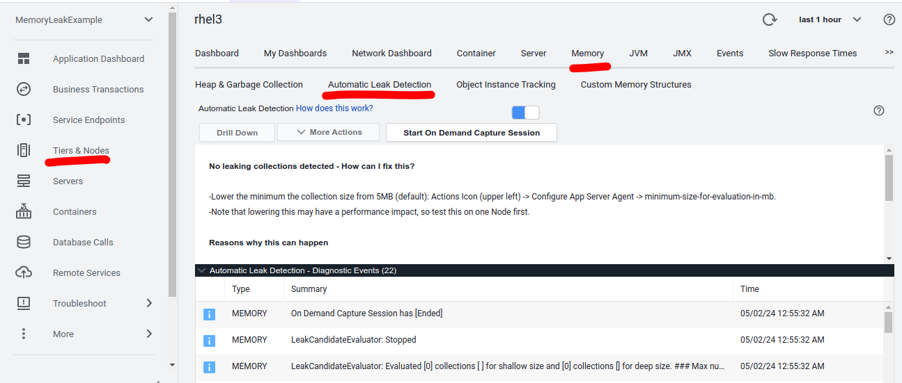

## Troubleshooting Java Memory
--------------------------------------------------------
1. Automatic Leak Detection
2. Objet Instance Tracking

### Automatic Leak Detection
Automatic Leak Detection uses On Demand Capture Sessions to capture any actively used collections (i.e. any class that implements JDK 'Map' or 'Collection' interface) during the 'Capture' period (default is 10 minutes). 

### Objet Instance Tracking
1. Excessive number of objects of certain class
2. Objects with unusually large size
