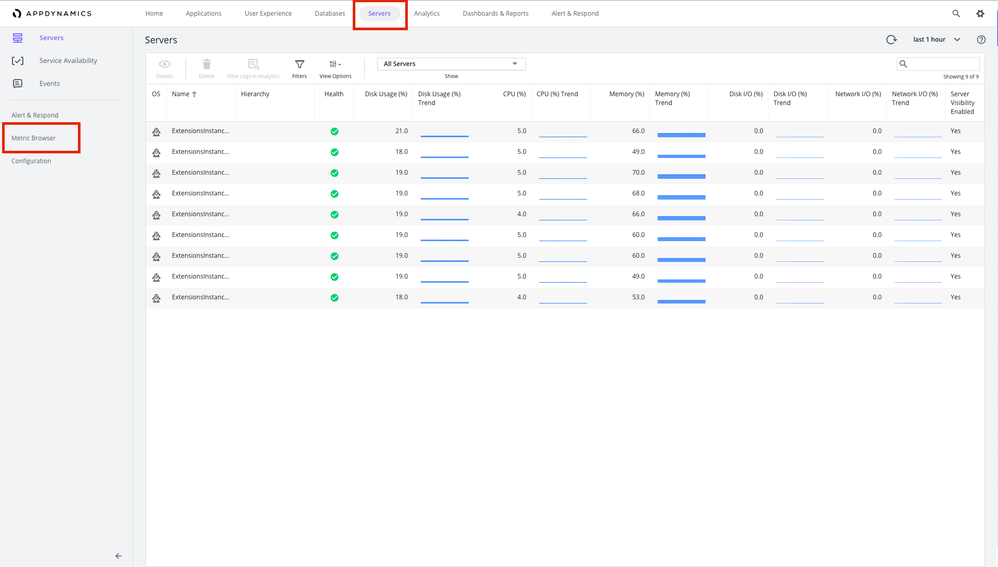
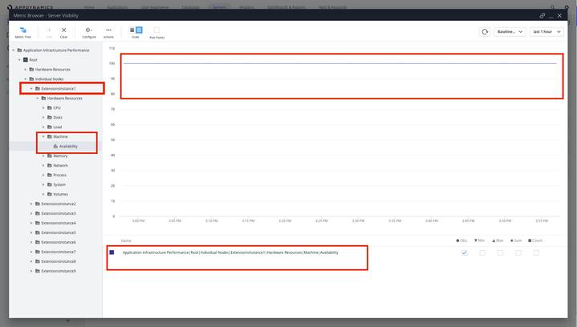
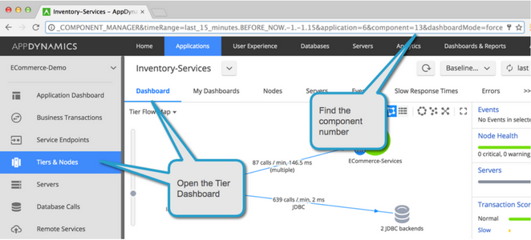
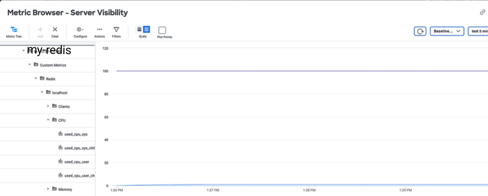

### Start Machine Agent
~~~sh
cd /opt/appdynamics/machineagent

jre/bin/java -jar machineagent.jar
~~~

### Extensions et Monitors
- toute metrique doit être remonté au controlleur toutes les 300 seconds au plus(donc il faut moins): **monitor.xml**
- Penser à augmenter la JVM de ta machine Agent 

### Manage Machine Agents
click Settings > Agent Management > Manage Agents. it permits you check **Uniq Host ID** of the machine and others stuffs.

### Configurer la machine agent
- **Xmx/Xms**: editer  **JAVA_OPTS** dans *appdynamics-machine-agent.service*. mettre 512Mo s'il y a des extensions.
- **controller-info.xml** : contient config pour se connecter au controlleur.
- Enable Server Visibility: in controller-info.xml  **<sim-enabled>**

### Machine Agent and App Agent on the Same Machine, but Report to Different Nodes
Machine agent and App Serer agent must have the same **uniqueHostId**:

- AGENT_OPTIONS="-Dappdynamics.agent.uniqueHostId='<shortHostName>'" : pour l'App Server agent
- <unique-host-id> : dans controller-info.xml pour la machine agent

See this excellent [Note](https://help.splunk.com/en/appdynamics-on-premises/infrastructure-visibility/26.3.0/machine-agent/administer-the-machine-agent/faqs-and-troubleshooting-for-the-machine-agent)

### Monitoring Extensions Prerequisites
https://community.splunk.com/t5/AppDynamics-Knowledge-Base/Monitoring-Extensions-Prerequisites-Guide/ta-p/727060

**Server Infrastructure & Monitoring (SIM)**: Server visibily licence is mandatory

### Machine agent installation scenarios
1. Co-installation avec App Agent (même serveur)
  - Ne pas configurer applicationName ni tierName.
  - Les métriques sont associées aux nœuds via le **uniqueHostId** qui doit être identique sur App agent et Machine agent.
  - The server metric are repoted in "Browser Metrics" under Servers
  

2. Installation indépendante (sans App Agent)
  - Aucun paramètre application/tier requis par défaut.
  - Les métriques sont visibles dans la liste des serveurs ou le metric browser.

**Rattachement des métriques à une application (installation indépendante)**

Configurer : 
- applicationName, tierName, nodeName
- uniqueHostId (identique côté Machine Agent et App Agent)
- 

### Redis Cache Monitor

https://community.splunk.com/t5/AppDynamics-Knowledge-Base/Setting-up-Redis-and-Monitoring-with-Splunk-AppDynamics/ta-p/731284
1. Pre-requis

   - Machine Agent: deja installé avec application/tier/node definis.
   - Compiler le code du monitor redis 

2. Installation
~~~
unzip target/RedisMonitor-*.zip -d MachineAgent_Dir/monitors/
~~~

3. Configuration : config.yaml
~~~
metricPrefix: "Server|Component: Compenent ID|Custom Metrics|Redis"
~~~

Compenent ID: peut etre tier-name ou tier-ID. ci-dessous pour trouver le compenet id

Component ID:

Notes: 
- The extension cannot report to a different tier than its Machine Agent's tier

4. Verifier les metrics sous AppDynamics

   - Se connecter sur le controller
   - Aller à: **Application → Tiers → Node → Metric Browser → Custom Metrics → MyApp → etc**

   
   
   Vérifie la présence des metriques comme:
  
    - used_memory, 
    - connected_clients 
    - keyspace_hits
    
  5. Tu peux creer ton **dashbord** rt tes **alertes**
  
### Eastic Search Extension
https://developer.cisco.com/codeexchange/github/repo/Appdynamics/elasticsearch-monitoring-extension/

### Log monitor
https://developer.cisco.com/codeexchange/github/repo/Appdynamics/log-monitoring-extension/

### Extensions
https://developer.cisco.com/codeexchange/search?q=Appdynamics

