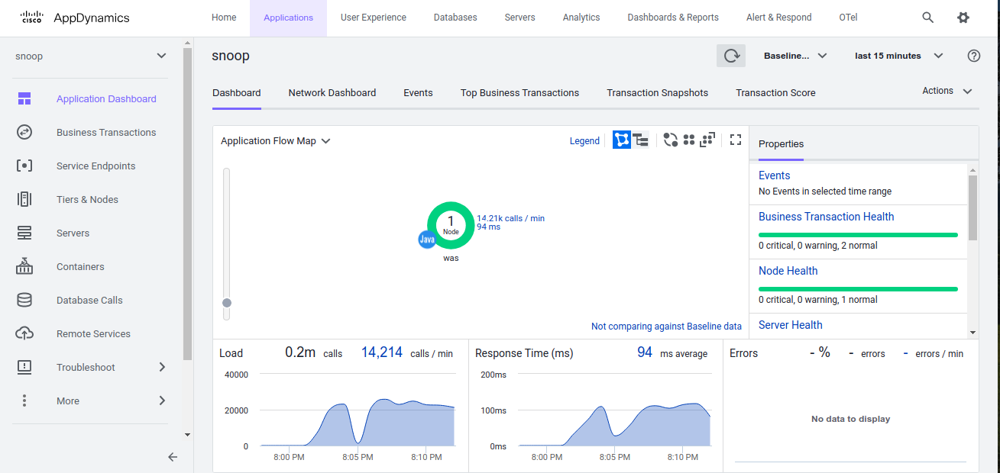
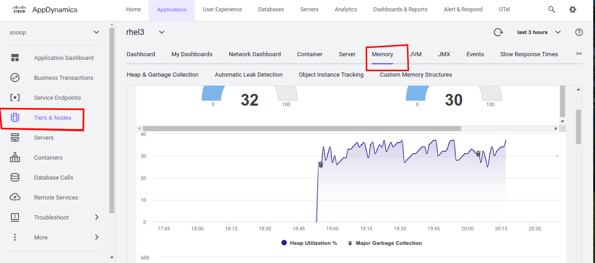
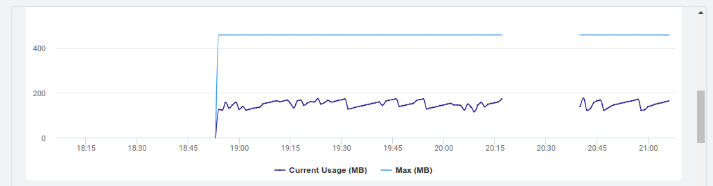
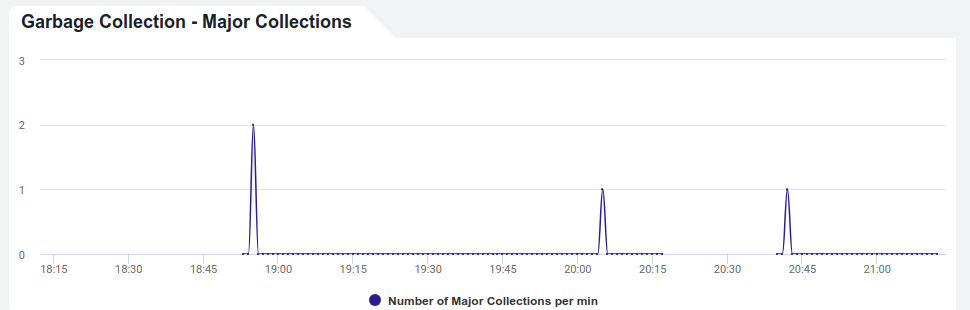
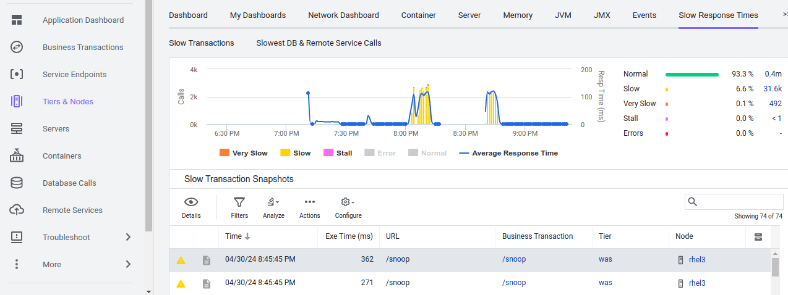

## Monitor Critical Metrics
---------------------------------------------------------
### Throughput 
throughput named **Load** : debit. nb the calls to the application in a given time.
### Response Time

### Java Heap utilisation

### Slow Response Time

### Database Response Time
### Slowest Databse calls
### GC 
