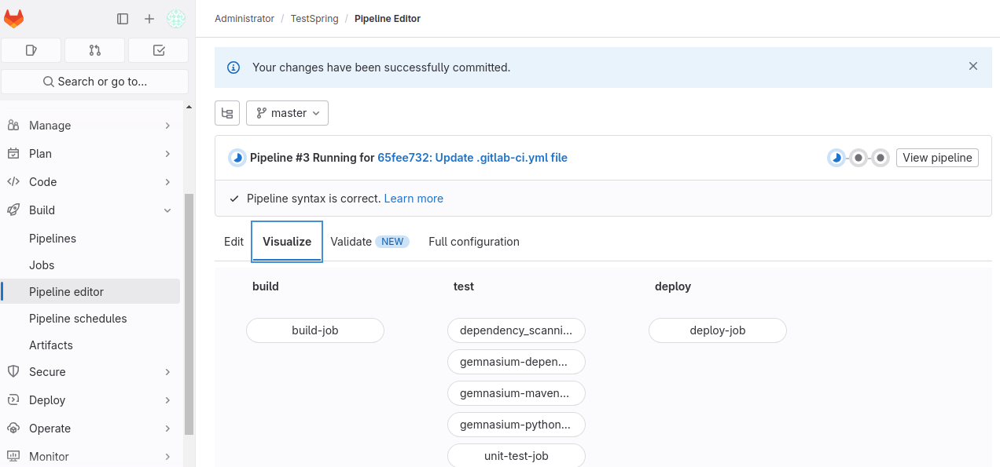

### Notes
- **Protected** variables are available only to pipelines that run on protected branches or [protected tags](https://docs.gitlab.com/user/project/protected_tags/).

- **Input parameters**: CI configurations (templates, components or .gitlab-ci.yml) and assigned values when a pipeline is triggered.
~~~YAML
spec:
  inputs:
    VERSION:     
      description: "set version to be deployed"
---
~~~

### Pipelines
Pipelines are defined in `.gitlab-ci.yml` file at the root of the project.

a Pipeline are structred as stages(compile, test, deploy) and jobs within stages:
  - **Stages** run sequentially. 
  - **Jobs** within the same stage run concurrently.

Example:
~~~yaml
stages:          # List of stages for jobs, and their order of execution
  - build
  - test
  - deploy

include:
  - template: Security/Dependency-Scanning.gitlab-ci.yml

build-job:       # This job runs in the build stage, which runs first.
  stage: build
  script:
    - mvn package

unit-test-job:   
  stage: test    
  script:
    - echo "Running unit tests... This will take about 60 seconds."
    - sleep 60
    - echo "Code coverage is 90%"

deploy-job:     
  environment: production 
  stage: deploy  
  script:
    - echo "Deploying application..."
    - echo "Application successfully deployed."
~~~

### Worflow
**worflow** controle l'execution de tout le pipeline. dans l'exemple ci-dessous, le pipeline n'est lancé que s'il y a un nouveau commit sur la branche main.

~~~yaml
workflow:
  rules:
    - if: $CI_COMMIT_BRANCH == "main"
~~~

### Components
Permet la création et la création de templates.
~~~yaml
include:
  - component: $CI_SERVER_FQDN/my-org/argo-cd/sync@1.0.0
    inputs:
      stage: sync-chart
~~~

