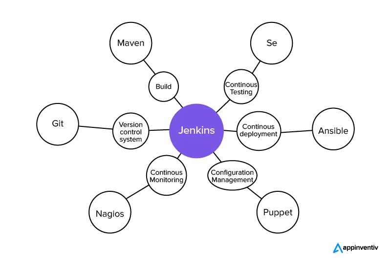
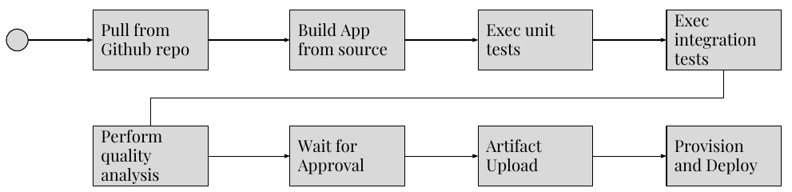
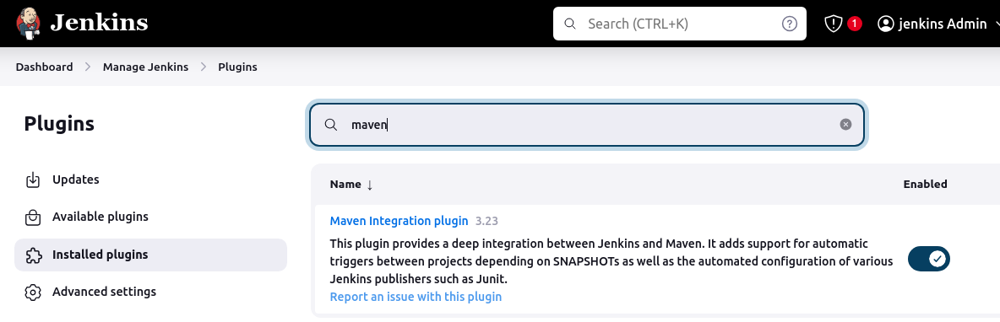
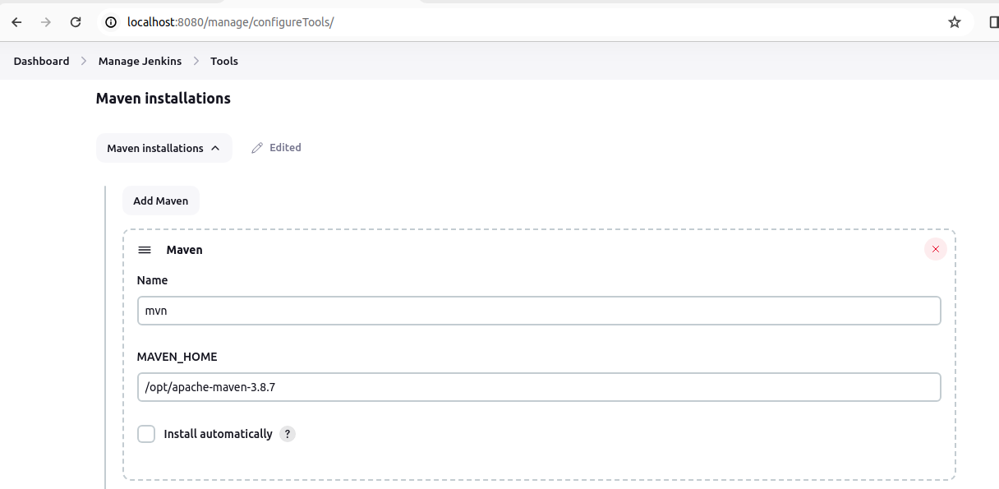
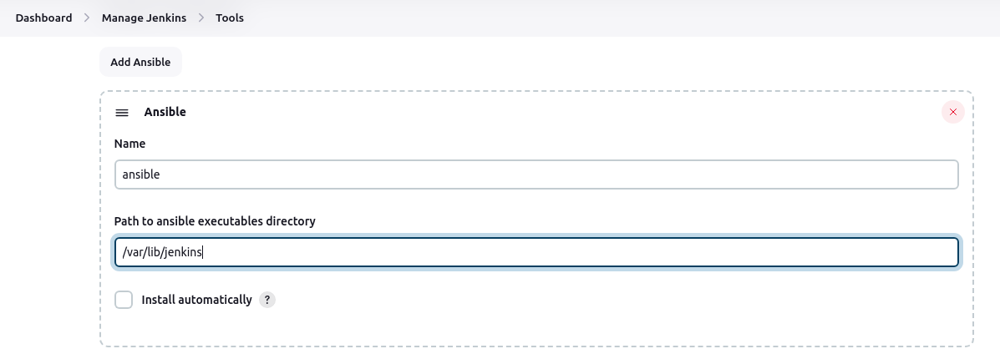

### Concepts
C**I/CD**: Continuous Integration/Delivery

**Pipeline**: 

**JenkinsFile**: 

### Architecture



### Gitlab - Jenkins Integration
https://medium.com/@maheshwar.ramkrushna/integrating-jenkins-with-gitlab-using-personal-access-tokens-for-secure-ci-cd-automation-1b9d73f517c8

### Pipeline
Example 


### Jenkins, Git and Maven Integration
Git and Maven must be installed on the machine.

**Integrate Maven into Jenkins**
1. Install Maven Plugin 

2. Setup Maven Installation Home


### Change Maven Version Inside Pipeline
**Jenkinsfile**
~~~grouvy
pipeline {
    agent any
    tools {
      // maven installation declared in Jenkins "Global Tool Configuration"
      maven 'maven-3.8.7'
    }
    stages {
        stage('Build') { 
            steps {
                 sh 'mvn -B -DskipTests clean package'
            }
        }
    }
}
~~~ 

### Pipeline: snippets
`jenkinsfile`

**Creer un sous-repertoire sous home et y faire un git checkout**
```
stage('Checkout branche recette') {
      steps {
        dir('config-rec') {
          git branch: 'recette',
              url: "${env.CONFIG_REPO_URL}",
              credentialsId: 'bitbucket-credentials'
        }
        echo "Branche recette récupérée"
      }
    }
```

### Jenkins & Ansible
1. Install Ansible Plugin in Jenkins
2. Configure Ansible in Jenkins
