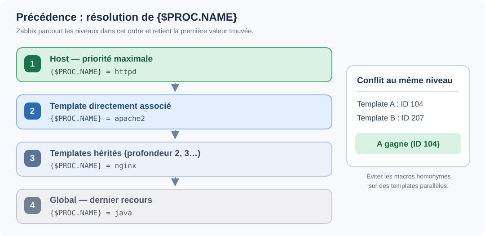

# Zabbix

**Objectif :** superviser un processus `httpd` sur RHEL et `apache2` sur Ubuntu avec **un seul template**, des macros surchargeables et une alerte anti-faux positifs. Exemples applicables à Zabbix 7.x/8.x (interface selon version).

## 1. Les objets Zabbix

| Objet | À quoi sert-il ? | Exemple |
|:--|:--|:--|
| **Host (hôte)** | Machine ou service réellement supervisé ; interface Agent, groupe, templates associés | `RHEL01` |
| **Template** | Modèle réutilisable appliqué à un ou plusieurs hôtes | `Template HTTPD` |
| **Item (élément)** | Collecte périodique d'une valeur | `proc.num[httpd]` |
| **Trigger (déclencheur)** | Expression calculée à partir des items, crée un événement **PROBLEM/OK** | processus absent pendant 2 min |
| **Macro utilisateur** | Paramètre configurable, utilisable dans les clés et seuils | `{$PROC.NAME}` |
| **LLD / Discovery** | Découvre automatiquement des ressources et crée items/triggers depuis des prototypes | interfaces, systèmes de fichiers |
| **Graph / Dashboard** | Affiche les métriques et leur évolution | nombre de processus |
| **Action** | Envoie une notification ou exécute une opération lors d'un événement | email/astreinte ; **configurée côté Zabbix**, pas automatiquement par le template |

Un **template ne supervise rien tout seul** : il doit être associé à un **host** doté du moyen de collecte approprié.

### Qui fait quoi, à quel niveau ?

| Niveau | Définition / exécution |
|:--|:--|
| **Template** | Item, trigger, valeurs par défaut des macros, discovery, graphiques |
| **Host** | Adresse/interface Agent, liaison au template, **surcharge** des macros |
| **Zabbix Server / Proxy** | Résolution des macros, orchestration des contrôles passifs, réception des valeurs ; le Server évalue les triggers |
| **Zabbix Agent sur Linux** | Exécute `proc.num[httpd]` et renvoie le nombre de processus |
| **Global Zabbix** | Macros globales et actions communes |

> **Mode de collecte de cet exemple :** item `Zabbix agent` **passif**. En mode actif, l'agent collecte et envoie les valeurs ; le schéma de transport change, pas le principe des macros.

## 2. Créer le template HTTPD

Dans **Data collection → Templates → Create template** :

- **Template name** : `Template HTTPD`
- **Template group** : groupe de templates existant (ex. `Templates/Applications`)

### Macros — onglet « Macros » du template

| Macro | Valeur par défaut | Rôle |
|:--|:--|:--|
| `{$PROC.NAME}` | `httpd` | Nom du processus Linux |
| `{$PROC.MIN}` | `1` | Minimum attendu avant alerte |

Les valeurs du template servent de **défaut**, pas de valeurs figées.

### Item — dans « Items → Create item »

| Champ | Valeur |
|:--|:--|
| **Name** | `HTTPD: Process count` |
| **Type** | `Zabbix agent` |
| **Key** | `proc.num[{$PROC.NAME}]` |
| **Type of information** | `Numeric (unsigned)` |
| **Update interval** | `30s` |
| **Enabled** | Oui |

Syntaxe exacte de la clé :

~~~text
proc.num[<name>,<user>,<state>,<cmdline>,<zone>]
~~~

`proc.num[httpd]` compte tous les processus dont le **nom** est `httpd`, tous utilisateurs et états confondus. Un résultat `0` signifie **aucun processus trouvé**, `5` signifie **cinq processus** (Apache peut avoir un parent et plusieurs workers).

La macro est résolue par **Zabbix**, pas par une variable d'environnement du serveur Linux :

~~~text
Template : proc.num[{$PROC.NAME}]
RHEL01   : {$PROC.NAME} = httpd   -> proc.num[httpd]
UBUNTU01 : {$PROC.NAME} = apache2 -> proc.num[apache2]
~~~

### Trigger — dans « Triggers → Create trigger »

**Name :** `HTTPD: Process is not running`  
**Severity :** `High` (à adapter à l'impact du service)

~~~zabbix
max(/Template HTTPD/proc.num[{$PROC.NAME}],2m)<{$PROC.MIN}
~~~

Avec `{$PROC.MIN}=1`, l'alerte apparaît si **la valeur maximale** du nombre de processus durant les deux dernières minutes reste **à 0**.

Comparaison :

~~~zabbix
# Détection immédiate (plus sensible aux redémarrages)
last(/Template HTTPD/proc.num[{$PROC.NAME}])<{$PROC.MIN}

# Détection persistante (recommandée ici)
max(/Template HTTPD/proc.num[{$PROC.NAME}],2m)<{$PROC.MIN}
~~~

> **Attention :** sans valeurs reçues, un `max()` ne prouve pas que le processus est arrêté. Surveiller séparément la perte de données de l'agent.

## 3. Associer le template aux hôtes et surcharger la macro

Dans **Data collection → Hosts**, ouvrir le host, associer `Template HTTPD` dans **Templates** puis vérifier **Macros**.

| Host | Macro `{$PROC.NAME}` au niveau Host | Valeur effective | Clé interrogée |
|:--|:--|:--|:--|
| `RHEL01` | non définie | `httpd` (héritée du template) | `proc.num[httpd]` |
| `UBUNTU01` | `apache2` | `apache2` (surcharge) | `proc.num[apache2]` |
| `RHEL02` | non définie | `httpd` (héritée du template) | `proc.num[httpd]` |

**Ne pas dupliquer le template pour changer un nom de processus** : définir la macro sur le host concerné.

## 4. Précédence des macros : qui gagne ?

Zabbix recherche une macro utilisateur `{$MACRO}` dans cet ordre :

1. **Host** — priorité la plus haute.
2. **Templates directement liés au host** — profondeur 1.
3. **Templates hérités par ces templates** — profondeur 2, puis 3, etc.
4. **Global** — priorité la plus basse.

**Conflit important :** si deux templates **au même niveau** définissent la même macro, **la valeur du template ayant le plus petit ID Zabbix est retenue**. Ce n'est ni l'ordre d'affichage ni l'ordre d'association : éviter cette collision.

Exemple :

| Niveau | `{$PROC.NAME}` |
|:--|:--|
| Host `RHEL01` | `httpd` |
| Template directement lié | `apache2` |
| Template ancêtre | `nginx` |
| Global | `java` |
| **Valeur effective** | **`httpd`** |

Si la macro n'existe pas au niveau Host, Zabbix descend dans l'héritage, puis cherche au niveau global. **Si elle n'existe nulle part, elle ne sera pas résolue.**

**Vérifier la valeur réelle :** **Data collection → Hosts → [hôte] → Macros → Inherited and host macros**.

### Autres familles de macros

| Catégorie | Syntaxe | Exemple d'usage |
|:--|:--|:--|
| **Utilisateur** | `{$PROC.NAME}` | paramètre modifiable |
| **Prédéfinie** | `{HOST.NAME}` | afficher le nom d'hôte dans une alerte |
| **LLD** | `{#FSNAME}` | nom de partition découvert automatiquement |
| **Utilisateur avec contexte** | `{$FS.PFREE.MIN.CRIT:"/"}` | seuil adapté à la partition `/` |

Une **macro LLD** vient d'une règle de découverte ; elle n'est pas la même chose qu'une macro utilisateur à surcharger sur un host.

## 5. Tester réellement la supervision

### Côté Linux

~~~bash
# Nom réel du processus, processus Apache visibles
ps -eo pid,comm,args | grep -E '[h]ttpd|[a]pache2'

# Service RHEL ou Ubuntu, selon l'OS
systemctl status httpd
systemctl status apache2

# Tester l'item sur le host où tourne l'agent
zabbix_agentd -t 'proc.num[httpd]'
# ou Agent 2
zabbix_agent2 -t 'proc.num[httpd]'

# Exemple sous Ubuntu
zabbix_agent2 -t 'proc.num[apache2]'
~~~

**Résultat attendu :** un entier `>= 1` si Apache tourne. Pour un item passif, contrôler aussi la connectivité **Zabbix Server/Proxy → Agent TCP 10050** et la configuration `Server=` / `ListenPort=`.

### Côté Zabbix

1. **Monitoring → Latest data** : filtrer le host, chercher `HTTPD: Process count`. Confirmer des valeurs récentes.
2. **Data collection → Hosts → Items** : consulter l'état de l'item ; lancer **Test** ou **Execute now** si disponible.
3. **Host → Macros → Inherited and host macros** : vérifier le nom de processus **effectif**.
4. **Monitoring → Problems** : constater l'événement après absence persistante.
5. Tester en **recette** (arrêt/redémarrage contrôlé d'Apache) avant d'activer les notifications de production.

### Diagnostics rapides

| Symptôme | Vérification |
|:--|:--|
| `proc.num` renvoie toujours `0` | Nom réel (`httpd` vs `apache2`) ; utilisateur ; commande `ps` |
| Item `Not supported` | Clé, agent/version, paramètres, logs Agent |
| Pas de valeurs | Agent actif, port 10050, proxy, pare-feu, interface Host |
| Alerte jamais déclenchée | Macro héritée, fenêtre 2 min, données récentes, trigger actif |
| Alerte après chaque restart | Garder `max(...,2m)` ; ajuster la fenêtre |
| Apache présent mais HTTP indisponible | Ajouter une sonde HTTP : présence du processus **≠** disponibilité applicative |

### Compléter la supervision pour la production

- **Perte de collecte** : un trigger distinct, par exemple `nodata(/Template HTTPD/proc.num[{$PROC.NAME}],3m)=1`, pour distinguer **absence de données** et **absence de processus**.
- **Disponibilité HTTP** : web scenario/HTTP Agent sur une URL de santé réelle, avec contrôle du code de réponse.
- **Notification** : une **Action** côté Zabbix routant le trigger vers le bon groupe d'astreinte ; éviter d'envoyer une alerte critique pour chaque redémarrage technique prévu.

## 6. Fiche récapitulative

~~~text
TEMPLATE : Template HTTPD
  macros   {$PROC.NAME} = httpd ; {$PROC.MIN} = 1
  item     proc.num[{$PROC.NAME}] ; Zabbix agent ; 30s
  trigger  max(/Template HTTPD/proc.num[{$PROC.NAME}],2m)<{$PROC.MIN}

HOST RHEL01
  template = Template HTTPD
  -> proc.num[httpd]

HOST UBUNTU01
  template = Template HTTPD
  macro {$PROC.NAME} = apache2
  -> proc.num[apache2]

PRÉCÉDENCE
  Host > templates directs > templates hérités (par profondeur) > Global
  Ex aequo entre templates au même niveau : plus petit ID
~~~

## 7. Superviser une URL `/health` (Web Scenario)

**Cas pratique :** Spring Boot Actuator, URL différente pour INT / REC / PROD. Le contrôle est effectué **depuis Zabbix Server ou Zabbix Proxy** (et non depuis l'agent Linux).

~~~text
GET https://monapp.example.com/actuator/health
HTTP/1.1 200 OK

{"status":"UP"}
~~~

### Niveau Template : macros et scénario

Créer le template **`Template HTTP Health`** depuis **Data collection → Templates**.

| Élément | Paramètre | Valeur |
|:--|:--|:--|
| **Macro (template)** | `{$HEALTH.URL}` | `https://monapp.example.com/actuator/health` |
| **Web scenario** | Name | `Application Health` |
| | Update interval | `1m` |
| | Attempts | `1` |
| **Step** | Name | `GET health` |
| | URL | `{$HEALTH.URL}` |
| | Timeout | `5s` |
| | Required status codes | `200` |
| | Required string (regex) | `"status"\s*:\s*"UP"` |

Créer le scénario depuis **Data collection → Templates → Template HTTP Health → Web → Create web scenario**, puis ajouter le step. L'expression régulière cherche le statut `UP` malgré d'éventuels espaces dans le JSON.

**Condition de succès :** la réponse a le code HTTP **200** **et** contient la chaîne attendue. Un HTTP 200 avec `{"status":"DOWN"}` fait échouer le step.

### Niveau Template : items automatiques et triggers

Le Web Scenario crée automatiquement ces items :

| Item | Rôle |
|:--|:--|
| `web.test.fail[Application Health]` | `0` : scénario réussi ; valeur positive : numéro du step échoué |
| `web.test.rspcode[Application Health,GET health]` | Dernier code HTTP obtenu |
| `web.test.time[Application Health,GET health,resp]` | Temps de réponse en secondes |
| `web.test.error[Application Health]` | Message d'erreur du dernier scénario |

### Triggers : 5 min KO, puis 2 contrôles OK

**PROBLEM — 6 échecs consécutifs, soit 5 minutes entre le premier et le sixième relevé** (avec un contrôle toutes les minutes) :

~~~zabbix
count(/Template HTTP Health/web.test.fail[Application Health],#6)=6
and
min(/Template HTTP Health/web.test.fail[Application Health],#6)>0
~~~

- `count(...,#6)=6` : attendre **au moins 6 mesures** ; évite une alerte dès le premier KO après création de l'item.
- `min(...,#6)>0` : **les 6 dernières mesures sont toutes KO** (un seul OK, valeur `0`, empêche l'alerte).
- `Attempts = 1` : pas de tentative supplémentaire dans le même scénario. La **fréquence reste 1m**.

**RECOVERY — 2 succès consécutifs :**

Dans le trigger, choisir **OK event generation → Recovery expression** et saisir :

~~~zabbix
max(/Template HTTP Health/web.test.fail[Application Health],#2)=0
~~~

`max(...,#2)=0` signifie que **les 2 dernières mesures sont OK**. Zabbix clôture l'incident quand **l'expression PROBLEM est fausse ET l'expression RECOVERY est vraie**.

> **Attention :** `#6` signifie 6 valeurs reçues, pas une durée garantie. Si des collectes manquent ou sont retardées, les six mesures peuvent couvrir plus de 5 minutes. Superviser la collecte avec un trigger `nodata()` distinct.

### Comprendre les paramètres de min() et max()

~~~text
min(/host/item,period[:time_shift])
max(/host/item,period[:time_shift])
~~~

| Paramètre | Rôle | Exemple |
|:--|:--|:--|
| `/host/item` | Hôte (ou template) et clé de l'item | `/Template HTTP Health/web.test.fail[Application Health]` |
| `period` | Période réelle ou nombre d'échantillons | `5m` ou `#6` |
| `:time_shift` | Décalage temporel facultatif **dans le 2e argument** | `5m:now-1h` |

| Expression | Lecture |
|:--|:--|
| `min(...,5m)` | Plus petite valeur **reçue dans les 5 dernières minutes** |
| `min(...,#6)` | Plus petite des **6 dernières valeurs** |
| `max(...,#2)` | Plus grande des **2 dernières valeurs** |
| `min(...,5m:now-1h)` | Minimum sur 5 min **il y a une heure** |

Exemple : valeurs `1, 1, 0, 1, 1` → `min = 0` (au moins un OK), `max = 1` (au moins un KO).

**Trigger — réponse lente (moyenne > 2 s sur 5 min) :**

~~~zabbix
avg(/Template HTTP Health/web.test.time[Application Health,GET health,resp],5m)>2
~~~

### Niveau Host : association et surcharge

| Host Zabbix | Macro `{$HEALTH.URL}` définie sur le Host |
|:--|:--|
| `APP-INT` | `https://app-int.example.com/actuator/health` |
| `APP-REC` | `https://app-rec.example.com/actuator/health` |
| `APP-PROD` | `https://app.example.com/actuator/health` |

Associer **`Template HTTP Health`** aux hôtes. La macro **Host** est prioritaire sur celle du template : **un seul template suffit** pour les trois environnements.

### Contrôles de production

- Depuis le **Zabbix Server/Proxy**, tester `curl -i --max-time 5 https://.../actuator/health` (DNS, routage, proxy sortant, TLS et authentification si nécessaire).
- Vérifier le résultat dans **Monitoring → Latest data**, puis **Monitoring → Problems**.
- Créer une alerte **perte de supervision** distincte après **3 minutes sans donnée** : `nodata(/Template HTTP Health/web.test.fail[Application Health],3m)=1`. Ne pas assimiler une absence de mesures à un HTTP KO.
- Pour détailler des composants comme `db`, `redis` ou `diskSpace`, préférer **HTTP Agent + JSONPath** à un simple contrôle global `UP`.

**Choix :** **Web Scenario** pour disponibilité / code HTTP / latence ; **HTTP Agent** pour exploiter le JSON comme métriques indépendantes.

## Références officielles

- [Zabbix — Templates](https://www.zabbix.com/documentation/current/en/manual/config/templates)
- [Zabbix — Création d'un template](https://www.zabbix.com/documentation/current/en/manual/config/templates/template)
- [Zabbix — User macros : héritage, précédence et conflits](https://www.zabbix.com/documentation/current/en/manual/config/macros/user_macros)
- [Zabbix — User macros avec contexte](https://www.zabbix.com/documentation/current/en/manual/config/macros/user_macros_context)
- [Zabbix Agent — `proc.num[]`](https://www.zabbix.com/documentation/current/en/manual/config/items/itemtypes/zabbix_agent)
- [Zabbix — Trigger expressions](https://www.zabbix.com/documentation/current/en/manual/config/triggers/expression)
- [Zabbix — Configurer un host et ses macros](https://www.zabbix.com/documentation/current/en/manual/config/hosts/host)

- [Zabbix — Web monitoring / Web scenarios](https://www.zabbix.com/documentation/current/en/manual/web_monitoring)
- [Zabbix — Web monitoring items](https://www.zabbix.com/documentation/current/en/manual/web_monitoring/items)
- [Zabbix — HTTP Agent](https://www.zabbix.com/documentation/current/en/manual/config/items/itemtypes/http)
- [Zabbix — Aggregate functions : min(), max(), count()](https://www.zabbix.com/documentation/current/en/manual/config/triggers/expression/aggregate)
- [Zabbix — Configuring a trigger : Recovery expression](https://www.zabbix.com/documentation/current/en/manual/config/triggers/trigger)
