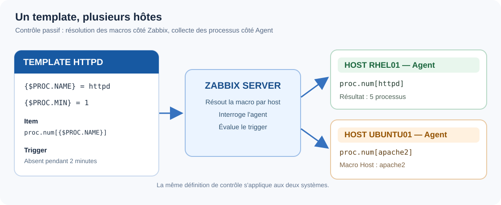
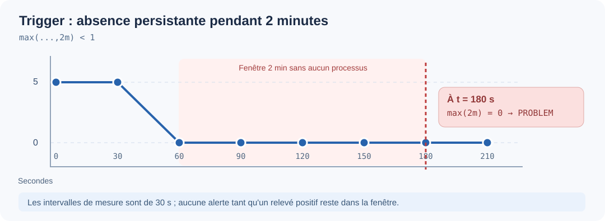
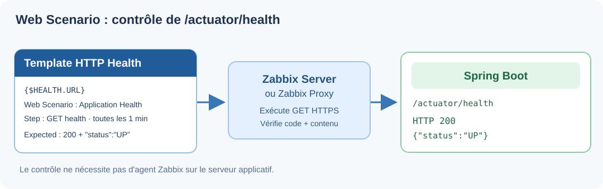

# Zabbix

Deux contrôles réutilisables : **présence d'Apache** et **disponibilité d'un endpoint /health**. Les seuils et les cibles sont paramétrés par macros, sans dupliquer les templates.

## Templates, items et macros

| Objet | Où ? | Usage |
|:--|:--|:--|
| **Template** | Data collection → Templates | Définit items, triggers, macros par défaut, LLD, graphes |
| **Host** | Data collection → Hosts | Interface de collecte, templates associés, macros surchargées |
| **Item** | Template | Collecte une valeur à intervalle fixe |
| **Trigger** | Template | Évalue les valeurs, produit PROBLEM / OK |
| **Action** | Alerts → Actions | Route les événements vers les destinataires |
| **Agent** | Serveur Linux | Exécute les clés d'items (ex. `proc.num[]`) |

Un template seul ne collecte rien : il s'applique à un host. Pour un item **Zabbix agent passif**, Zabbix Server/Proxy interroge l'agent ; un **Web Scenario** est exécuté côté Server/Proxy, sans agent Linux.

### Précédence des macros utilisateur

**Host → template directement lié → templates hérités (par profondeur) → Global.**

À profondeur égale, si plusieurs templates définissent la même macro, **le plus petit ID de template gagne**. Éviter ces collisions.

Pour contrôler la valeur appliquée : **Data collection → Hosts → Macros → Inherited and host macros**.

Autres syntaxes à connaître : `{HOST.NAME}` (macro prédéfinie), `{#FSNAME}` (LLD), `{$FS.PFREE.MIN.CRIT:"/"}` (macro utilisateur avec contexte).

## 1. Présence du processus HTTPD

Créer **`Template HTTPD`**.

| Niveau | Paramètre | Valeur |
|:--|:--|:--|
| Template / Macros | `{$PROC.NAME}` | `httpd` |
| Template / Macros | `{$PROC.MIN}` | `1` |
| Template / Items | Name | `HTTPD: Process count` |
| | Type / Key | `Zabbix agent` / `proc.num[{$PROC.NAME}]` |
| | Interval / Type of information | `30s` / `Numeric (unsigned)` |
| Template / Triggers | Name / Severity | `HTTPD: Process is not running` / `High` |

**Trigger — processus absent pendant les contrôles des 2 dernières minutes :**

~~~zabbix
max(/Template HTTPD/proc.num[{$PROC.NAME}],2m)<{$PROC.MIN}
~~~

`proc.num[]` compte les processus (pas le service systemd). Apache peut avoir plusieurs workers : `5` n'est pas une anomalie. Pour une détection immédiate, utiliser `last()` plutôt que `max()`.

**Surcharge sur les hosts :**

| Host | `{$PROC.NAME}` effectif | Item évalué |
|:--|:--|:--|
| RHEL01 | `httpd` (template) | `proc.num[httpd]` |
| UBUNTU01 | `apache2` (host) | `proc.num[apache2]` |

Vérification sur Linux :

~~~bash
ps -eo pid,comm,args | grep -E '[h]ttpd|[a]pache2'
zabbix_agent2 -t 'proc.num[httpd]'   # RHEL
zabbix_agent2 -t 'proc.num[apache2]' # Ubuntu
~~~

**À surveiller séparément :** absence de données Agent (l'absence de mesures n'est pas un arrêt d'Apache). Exemple :

~~~zabbix
nodata(/Template HTTPD/proc.num[{$PROC.NAME}],3m)=1
~~~

## 2. Disponibilité HTTP /actuator/health

Créer **`Template HTTP Health`** puis **Web → Create web scenario**. Ce contrôle part du **Zabbix Server/Proxy**, pas de la machine applicative.

| Niveau | Paramètre | Valeur |
|:--|:--|:--|
| Template / Macros | `{$HEALTH.URL}` | `https://monapp.example.com/actuator/health` |
| Web Scenario | Name | `Application Health` |
| | Update interval / Attempts | **`1m` / `1`** |
| Step | Name | `GET health` |
| | URL / Timeout | `{$HEALTH.URL}` / `5s` |
| | Required status codes | `200` |
| | Required string (regex) | `"status"\s*:\s*"UP"` |

Un HTTP 200 avec `"status":"DOWN"` reste **KO**.

L'item de décision est `web.test.fail[Application Health]` : **0 = OK**, **> 0 = numéro de l'étape en échec**.

### Stratégie d'alerte

**PROBLEM : six échecs consécutifs.** À un contrôle par minute, ils couvrent cinq minutes entre le premier et le dernier relevé.

~~~zabbix
count(/Template HTTP Health/web.test.fail[Application Health],#6)=6
and
min(/Template HTTP Health/web.test.fail[Application Health],#6)>0
~~~

**RECOVERY : deux contrôles OK consécutifs.** Régler **OK event generation → Recovery expression** :

~~~zabbix
max(/Template HTTP Health/web.test.fail[Application Health],#2)=0
~~~

Le retour à OK nécessite que l'expression PROBLEM soit fausse **et** l'expression RECOVERY vraie.

**Perte de collecte (trigger distinct) :**

~~~zabbix
nodata(/Template HTTP Health/web.test.fail[Application Health],3m)=1
~~~

> `#6` désigne **six valeurs**, pas strictement cinq minutes : un retard de collecte décale l'alerte. `count(...,#6)=6` évite un déclenchement dès les premiers échantillons après création de l'item.

**Par environnement :** associer le même template aux hosts `APP-INT`, `APP-REC` et `APP-PROD` ; surcharger seulement `{$HEALTH.URL}` sur chaque host.

Autres métriques issues du scénario :

| Item | Usage |
|:--|:--|
| `web.test.rspcode[Application Health,GET health]` | Code HTTP |
| `web.test.time[Application Health,GET health,resp]` | Temps de réponse (s) |
| `web.test.error[Application Health]` | Dernière erreur |

Pour la latence (exemple, moyenne > 2 s sur 5 min) :

~~~zabbix
avg(/Template HTTP Health/web.test.time[Application Health,GET health,resp],5m)>2
~~~

Si l'objectif est d'extraire `db`, `redis` ou `diskSpace` du JSON, préférer un **HTTP Agent** avec preprocessing JSONPath.

## 3. Rappel sur min(), max() et leurs paramètres

~~~text
min(/host/item,period[:time_shift])
max(/host/item,period[:time_shift])
~~~

| Expression | Signification |
|:--|:--|
| `min(...,5m)` | Minimum des valeurs collectées durant les 5 dernières minutes |
| `min(...,#6)` | Minimum des 6 dernières valeurs |
| `max(...,#2)` | Maximum des 2 dernières valeurs |
| `min(...,5m:now-1h)` | Minimum sur 5 minutes, une heure dans le passé |

Pour `web.test.fail` : **`min > 0` = tous KO** ; **`max = 0` = tous OK**. Le décalage `:time_shift` fait partie du **deuxième paramètre**, pas d'un troisième argument.

## 4. Fonctions de Trigger indispensables

| Fonction | Rôle | Exemple |
|:--|:--|:--|
| `last()` | Dernière valeur reçue | `last(/srv/item)>90` |
| `min()` | Plus petite valeur de la période | `min(/srv/item,5m)>90` : toutes les valeurs > 90 |
| `max()` | Plus grande valeur de la période | `max(/srv/item,5m)=0` : toutes les valeurs = 0 |
| `avg()` | Moyenne sur une période | `avg(/srv/item,5m)>80` |
| `count()` | Nombre de valeurs, éventuellement filtrées | `count(/srv/item,#6)=6` : six échantillons disponibles |
| `nodata()` | Absence de nouvelles données | `nodata(/srv/item,5m)=1` |

**Lecture opérationnelle :** `last()` réagit immédiatement ; `min()` et `max()` imposent une condition sur une fenêtre ; `avg()` lisse les variations ; `count()` fiabilise le nombre d'échantillons.

~~~zabbix
# Processus absent sur toutes les mesures des 2 dernières minutes
max(/Template HTTPD/proc.num[{$PROC.NAME}],2m)=0

# Aucune mesure reçue depuis 3 minutes (alerte distincte)
nodata(/Template HTTPD/proc.num[{$PROC.NAME}],3m)=1
~~~

**Attention :** une fonction calculée sur une fenêtre ne garantit pas un contrôle chaque minute. Associer `count(...,#N)` lorsqu'un nombre minimum de mesures est requis ; superviser `nodata()` séparément.

## 5. Templates, macros et découverte automatique (LLD)

- **Template** : centralise items, triggers et découvertes ; on l'associe à plusieurs hosts.
- **Macro utilisateur** `{$PROC.NAME}` : paramètre réutilisable, surchargeable au niveau du host.
- **LLD (Low-Level Discovery)** : découvre des ressources et instancie leurs *item prototypes* et *trigger prototypes* automatiquement.

**Exemple de réutilisation** — le template `Template HTTPD` contient :

~~~text
Macro  {$PROC.NAME} = httpd
Item   proc.num[{$PROC.NAME}]
~~~

Sur un host Ubuntu, définir `{$PROC.NAME}=apache2` : le même item supervisera `proc.num[apache2]`. Priorité des macros : **Host → Template direct → Templates hérités → Global** (voir le schéma plus haut).

**Exemple LLD : découverte des systèmes de fichiers**

~~~text
Discovery rule : vfs.fs.discovery
Macro LLD      : {#FSNAME}                 (/, /var, /home...)
Item prototype : vfs.fs.size[{#FSNAME},pfree]
~~~

À chaque filesystem découvert, Zabbix crée un item de pourcentage libre ; un *trigger prototype* peut ouvrir une alerte si le seuil est franchi. La macro LLD `{#FSNAME}` représente la ressource découverte : elle est différente d'une macro utilisateur `{$...}`.

Pour vérifier : **Data collection → Hosts → Discovery** (règles / prototypes) et **Monitoring → Latest data** (items créés).
## 6. Vérifications de production

- **Latest data** : valeurs et fréquence réellement reçues ; **Problems** : événements et récupération.
- **Macros héritées** : contrôler la valeur effective sur le host.
- **HTTP** : faire un `curl -i --max-time 5 <URL>` depuis le **Zabbix Server/Proxy** (DNS, TLS, routage, proxy, authentification).
- **Agent passif** : vérifier connectivité TCP 10050, `Server=` et logs de l'agent.
- **Notifications** : vérifier les Actions et tester l'arrêt contrôlé en recette.

## Références

- [Templates](https://www.zabbix.com/documentation/current/en/manual/config/templates)
- [Macros utilisateur et priorité](https://www.zabbix.com/documentation/current/en/manual/config/macros/user_macros)
- [Clés Zabbix Agent — proc.num](https://www.zabbix.com/documentation/current/en/manual/config/items/itemtypes/zabbix_agent)
- [Web scenarios](https://www.zabbix.com/documentation/current/en/manual/web_monitoring)
- [Métriques de Web Monitoring](https://www.zabbix.com/documentation/current/en/manual/web_monitoring/items)
- [Expressions / fonctions historiques](https://www.zabbix.com/documentation/current/en/manual/config/triggers/expression)
- [Triggers et Recovery expression](https://www.zabbix.com/documentation/current/en/manual/config/triggers/trigger)
