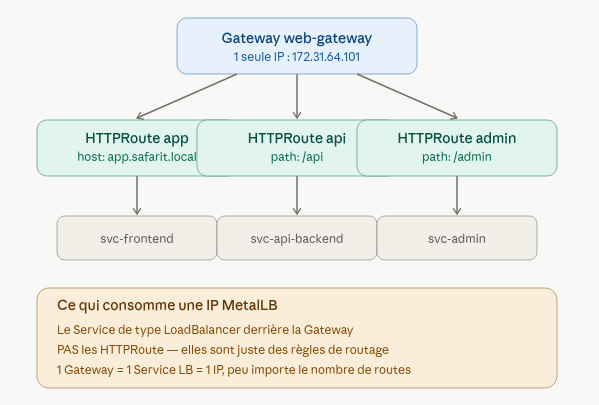

### Howtos
** List des Gateway**: `get -n sample gtw`


A partir de ton `gateway`, le controlleur crée automatiquement un service, qui va servir toutes routes attachées à lui. tu dois  utiliser son IP ou son EXTERNAL IP si son son type est `LoadBalancer`

```
k get svc
NAME                                   TYPE           CLUSTER-IP      EXTERNAL-IP     PORT(S)                        AGE
web-gateway-gateway-class-istio-demo   LoadBalancer   10.105.156.99   172.31.64.101   15021:31637/TCP,80:32167/TCP   74m

# Test
curl -H"Host: app.safarit.local" http://172.31.64.101
```


Une seule Gateway (donc une seule IP) peut avoir plusieurs HTTPRoute attachées, chacune routant selon le hostname ou le path vers un service backend différent. C'est exactement le but de la Gateway API : mutualiser une seule IP/Gateway pour plusieurs applications, au lieu d'exposer chaque service individuellement.


**Archi avec Istio/Envoy**: 
`Client → Gateway (Istio/Envoy) → HTTPRoute → Service → Pod`

Istio est basé sur Envoy Gateway pour inplementer le proxy/controller de la Gateway Api.


**Istio IngressGateway Controller**: istio-ingressgateway
```
k get -n istio-system deployments.apps
NAME                   READY   UP-TO-DATE   AVAILABLE   AGE
istio-ingressgateway   1/1     1            1           4d
```

**Gateway créé**: `k describe -n sample gateway helloworld-gateway`. permet de recuper le INGRESS HOST. ou via `get -n sample gateway sample-gateway  -o jsonpath='{.status.addresses[0].value}'`

**Service**: est céer autmatiquement pas le controlleur
```
kubectl get svc -n sample helloworld-gateway-istio
NAME                       TYPE           CLUSTER-IP      EXTERNAL-IP   PORT(S)     
helloworld-gateway-istio   LoadBalancer   10.96.234.111   <pending>     15021:32228/TCP,80:30796/TCP   
```
Le sevice ne peut affecter une IP, soit tu intalle Metallb, soit tu peux tester avec portforward `k port-forward -n sample svc/helloworld-gateway-istio 8080:80&`, et tu test `curl -HHost:helloworld.sample.com http://localhost:8080/hello`


**Metallb**
- IPAddressPool (voir template du role metallb): `172.31.64.100-172.31.64.120`,  Une plage IP libre du VPC qui va etre utilisé pour l'EXTERNAL-IP. Creer un subnet 172.31.64.0/20 sous le VPC
```
k get svc
NAME                              TYPE           CLUSTER-IP       EXTERNAL-IP     PORT(S)
gateway-demo-gateway-class-demo   LoadBalancer   10.100.7.201     172.31.64.101   15021:30602/
```


**Articles**:
 
  - Avec hellow world sample: https://istio.io/latest/blog/2022/getting-started-gtwapi/
  - 
  
**Check if gateway api CRDs are installed**: by default are not. ` k get crd gateways.gateway.networking.k8s.io`

**Install Gateway API** : `kubectl apply --server-side -f https://github.com/kubernetes-sigs/gateway-api/releases/download/v1.5.0/standard-install.yaml
`

**Istio Sample** : https://github.com/istio/istio/tree/release-1.29/samples/helloworld

**Gateway API**
```
k get gtw
k get httproute   
k get gatewayclasses
```

**Quel est svc IngressGateway?**:  `k get svc -n istio-system`

**Ce que fait Istio automatiquement**

  1. Cree un service comme le point d'entrée réseau pour ta Gateway
  2. Crée un pod Envoy dédié à cette gateway (pas l'ingressgateway partagé), et ce service LoadBalancer pointe dessus
  3. 
  

### Exemple HTTPRoute en HTTPS
1. metallb bien installé
2. Creer un deploiement : `k create deployment myapp --image nginx `
3. Expose le: `k expose  deployment myapp --name myapp-svc --port 80`
4. Creer le cert : `openssl req -x509 -newkey rsa:4096 -sha256 -days 365   -nodes -keyout myapp-key.pem -out myapp-cert.pem   -subj "/CN=myapp.safarit.local"   -addext "subjectAltName=DNS:myapp.safarit.local"`  
5. Creer le secret TLS: `k create secret tls myapp-tls --cert myapp-cert.pem --key myapp-key.pem`
4. Le metallb va reserver une EXTERNAL-IP pour le service LoadBalancer automatiquement, pointe sur  myapp.safarit.local la dans le /etc/hosts 

Note: Si la gateway a plusieurs listeners, utilise `sectionName: web-http` au niveau de la httproute pour cibler le bon

~~~yaml
apiVersion: gateway.networking.k8s.io/v1
kind: GatewayClass
metadata:
  name: nginx-class
  
spec:
  controllerName: istio.io/gateway-controller

---
apiVersion: gateway.networking.k8s.io/v1
kind: Gateway
metadata:
  name: web-gateway
spec:
  gatewayClassName: nginx-class
  listeners:
  - name: web-http
    protocol: HTTP
    port: 80
  - name: web-https
    protocol: HTTPS
    port: 443
    hostname: myapp.safarit.local
    tls:
      mode: Terminate
      # mode defaults to `Terminate` when omitted.
      certificateRefs:
      - kind: Secret
        group: ""
        name: web-tls
---
apiVersion: gateway.networking.k8s.io/v1
kind: HTTPRoute
metadata:
  name: web-route
spec:
  parentRefs:
  - name: web-gateway
    sectionName: web-http
  hostnames:
  - "myapp.safarit.local"
  rules:
  - backendRefs:
    - name: myapp-svc
      port: 80
~~~


### Docs
- https://devopscube.com/kubernetes-gateway-api/