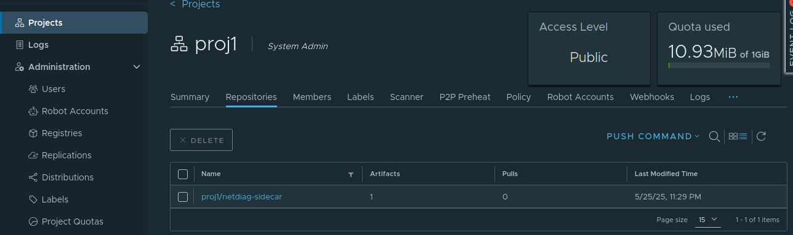

### Harbor
- Url: https://harbor.rahali.com:444
- Login: admin, password in default vars
- Creer un project: proj1
  - Sous le proj1, creer un **Robot Account** . Avec droits sur **Repository**, et **tag**
  - Noter le token, c'est le password
  - declarer harbor.rahali.com dans le /etc/hosts
    
**Push d'une image avec docker**
  ~~~
    docker login harbor.rahali.com:444
    Username: robot$proj1+prod 
    Password: 

    CHANGE_ME tag netdiag-sidecar:0.1.0 harbor.rahali.com:444/proj1/netdiag-sidecar:0.1.0

    docker push harbor.rahali.com:444/proj1/netdiag-sidecar:0.1.0
  ~~~

**Console Harbor**

