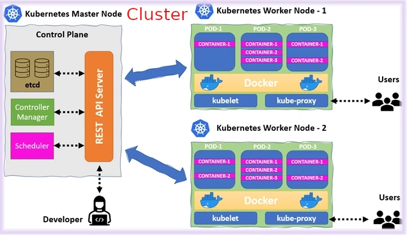

## Notes importantes
--------------------------------
- Mettre un label commun à touts les objets d'une application

~~~yaml
metadata:
  labels:
    app: myapp
~~~
Les labels permettent de filtrer toutes les ressources d’une appli avec : `kubectl get all,configmap -l app=myapp`. Pratique pour debugging, monitoring, ou cleanup.

- **Pour debugguer un pod qui crash et restart sans cesse**: figer le container, entrer dans son terminal ssh puis le demarrer(avec sa commade de start par exemple httpd start)
~~~
command: ["/bin/sh", "-c"]
args: ["sleep infinity"]
~~~

Ou bien 
~~~
oc logs -f deployment/argocd-application-controller -n devops312-dev
~~~

- Equivalence Listes et Tables dans les Yaml: ces deux ecritures sont strictement equivalentes

~~~
command: ["/bin/sh", "-c"]
args: ["sleep infinity"]

Equivalent à

command:
  - /bin/sh
  - '-c'
args:
  - sleep infinity
~~~

## Kubernetes
--------------------------------

### Aide mémoire Kubectl
[Lien](https://kubernetes.io/fr/docs/reference/kubectl/cheatsheet/
)

**SSH on a pod**
~~~
kubectl -n <namespace> exec -it <pod-name> -- /bin/bash

k exec -n <namespace> exec -it <pod-name> -- ls /tmp/
~~~

**Config**
  
  - Afficher la config: `kubectl config view --minify`
  - 
  

**Tester les Flux**

  Tester les flux vers mysql depuis un autre pod sur le meme cluster:
  ~~~
  telnet mysql-service.nom-du-namespace.svc.cluster.local 3306
  ~~~
  

**Creer un pod de test: Busybox**
  ~~~
  kubectl run -i --tty debug --image=busybox --restart=Always -n argocd -- sh
  ~~~

**Tranferer un fichier externe sur un pod avec kubectl**
~~~
kubectl cp my.txt <nom-du-pod>:/tmp/my.txt
~~~

**Port Forward**
~~~sh
k port-forward pods/nginx --address=0.0.0.0 8000:80
~~~
Le port sera ouvert sur la machine qui a lancé le forward

**Supprimer tous les pods d'un deployment**
~~~sh
kubectl delete pod -n kube-system -l app=antrea
~~~

**Kubectl Raccourcis**
~~~sh
k api-resources 

NAME                                SHORTNAMES                   

configmaps                          cm                                  
endpoints                           ep                                  
events                              ev                                  
limitranges                         limits                              
namespaces                          ns                                  
nodes                               no                                  
persistentvolumeclaims              pvc                                 
persistentvolumes                   pv                                  
....
~~~

**Tester avec curl sans modifier le /etc/hosts**
~~~sh
curl -H "Host: app.rahali.com" http://192.168.56.10
~~~

**NSlookup**
~~~
nslookup <mysql-demo-service>.<mysql-namespace>.svc.cluster.local
~~~

### ConfigMaps
ConfigMap is not designed to hold large chunks of data. 
The data stored in a ConfigMap cannot exceed 1 MiB.

### Service
Un Service a :
  - Une ``IP`` virtuelle stable (exemple : 10.43.200.1)
  - Un ou plusieurs ports (``port``), comme 80, 443, etc.
  - Un ``targetPort``(ex 8080) qui pointe vers les ports réels des Pods (dans les containers)

Quand un Pod envoie une requête à http://my-service:80, Kubernetes route vers un Pod cible sur :8080

Service de type ``NodePort`` expose ton application sur une IP de nœud + un port statique, accessible depuis l’extérieur du cluster, sans avoir besoin d’un Ingress ou LoadBalancer.

### Variables d'environnement
Les variables declarés dans ``env`` seront ajoutés comme varaiables d'enviornnement systeme du conteneur. Par exemple pour declarer **JAVA_OPTS** utilise **JAVA_TOOL_OPTIONS**
~~~
env:
    - name: JAVA_TOOL_OPTIONS
      value: "{{ .Values.javaOpts }}"
~~~

### Sidecar
Exemple de sidecar pour debugger les problemes reseaux. A ajouter dans votre deplyment.yaml
~~~
- name: nettools-sidecar
  image: nicolaka/netshoot
  command: [ "sleep", "infinity" ]
~~~

### Architecture

### kubectl
kubectl is the official command tool for managing kubernetes clusters.

**List pods running on your cluster**
~~~sh 
$ kubectl get pods -o wide
~~~

~~~log
NAME                       READY   STATUS    RESTARTS   AGE     IP           NODE           NOMINATED NODE   READINESS GATES
web                        1/1     Running   0          12m     10.0.1.127   kworker1-aws   <none>           <none>
web-depl-6b666d58b-89zzp   1/1     Running   0          2m52s   10.0.1.153   kworker1-aws   <none>           <none>
web-depl-6b666d58b-dp4r2   1/1     Running   0          9m52s   10.0.1.182   kworker1-aws   <none>           <none>
~~~

**List of Nodes**
~~~sh
$ kubectl get nodes
~~~

**Display Pod Console/Logs**
~~~sh
$ kubectl logs demo -n your-namespace
~~~

Les logs se trouvent sur le worker dans `/var/log/pods/<namespace_pod-id>/config`

**Afficher la Config**
~~~
k describe -n ingress-nginx services
~~~

**Affiche la config d'un pod sous fromat JSON**
~~~
kubectl  -n <namespace> get pod <pod-name> -o json
~~~

**Lister les conteneurs d'un pod**
~~~
kubectl  -n <namespace> get pod <pod-name> -o jsonpath='{range .spec.containers[*]}{.name}{"\n"}{end}'
~~~

**Acces en shell dans un Conteneur d'un POD**
~~~
kubectl exec -it my-pod -c sidecar -n default -- bash
~~~

**Lister les services**
~~~
kubectl get svc -n <namespace-name>
~~~

**Taint** : Savoir si les pods peuvent tourner sur le master
~~~sh
kubectl describe node kmaster | grep Taint

Taints:             node-role.kubernetes.io/control-plane:NoSchedule
~~~

### Activer l'Autocompltion
  ~~~
  sudo dnf install -y bash-completion
  echo '[ -f /etc/profile.d/bash_completion.sh ] && source /etc/profile.d/bash_completion.sh' >> ~/.bashrc
  source /etc/profile.d/bash_completion.sh
  echo 'source <(kubectl completion bash)' >> ~/.bashrc
  alias k=kubectl
  complete -o default -F __start_kubectl k
  source ~/.bashrc
  ~~~

### Create a Pod from YAML
- Create a *pod.yaml* file  

  ~~~yaml
  apiVersion: v1
  kind: Pod
  metadata:
	name: demo
  spec:
	containers:
	- name: testpod
	  image: almalinux:latest
	  command: ["ping", "8.8.8.8"]
  ~~~

- Deploy the Pod
  ~~~sh
  kubectl apply -f pod.yaml
  ~~~
- List Pods and Check Logs
  ~~~bash
  kubectl get pods
  kubectl logs demo
  ~~~
- Finaly tear your demo 
  ~~~sh
  kubectl delete -f pod.yaml
  ~~~

### Ingress
Ingress exposes HTTP and HTTPS routes from outside the cluster to services within the cluster. An Ingress may be configured to give Services externally-reachable URLs, load balance traffic, terminate SSL/TLS, and offer name-based virtual hosting.

### kubeconfig
- **kubeconfig** est un fichier de configutaion utilisé par les outils(comme kubectl, kubelet) pour se connecter à un cluster.
- **Context**: associe un user à un cluster.

**Emlacement** : ~/.kube/config
~~~
clusters:
- cluster:
    certificate-authority-data: DATA+OMITTED
    server: https://127.0.0.1:6443
  name: default
contexts:
- context:
    cluster: default
    user: default
  name: default
current-context: default
users:
- name: default
  user:
    client-certificate-data: DATA+OMITTED
    client-key-data: DATA+OMITTED
~~~

**Voir la config active**
~~~
kubectl config view
~~~

**Lister les context**
~~~
 kubectl config get-contexts 
~~~

**Changer de context**
~~~
kubectl config use-context my-context
~~~

### Controle Cluster remotely with kubectl
Sur la machine de control: 

- Install kubectl
  ~~~sh
  curl -LO https://dl.k8s.io/release/$(curl -Ls https://dl.k8s.io/release/stable.txt)/bin/linux/amd64/kubectl
  chmod +x ./kubectl
  mv ./kubectl /usr/local/bin/kubectl
  ~~~

- Set kubeconfig
  ~~~sh
  # copy the remote coonfig
  scp alma2:~/.kube/config ~/.kube/config
  # create a context
  kubectl config set-cluster k3s --server=https://192.168.57.12:6443 --insecure-skip-tls-verify
  kubectl config set-context k3s --cluster k3s --user default

  kubectl config view
  ~~~

- Changer le context et tester si l'acces est OK
  ~~~sh
  kubectl config use-context k3s
  kubectl config get-contexts

  kubectl get nodes
  ~~~

### Favoris
- [Kubernetes Concepts](https://kubernetes.io/docs/concepts)
- [Certified Kubernetes Administrator (CKA) Course](https://github.com/kodekloudhub/certified-kubernetes-administrator-course)