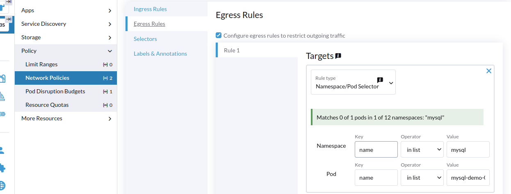
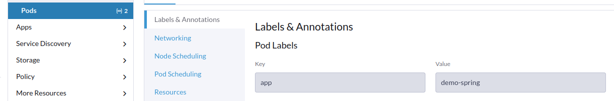
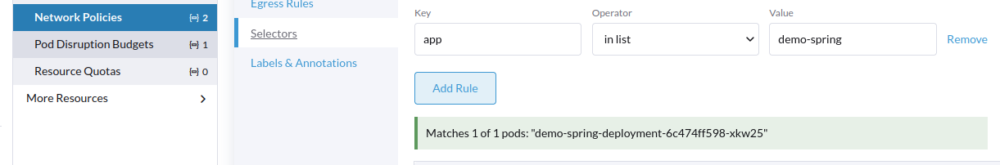
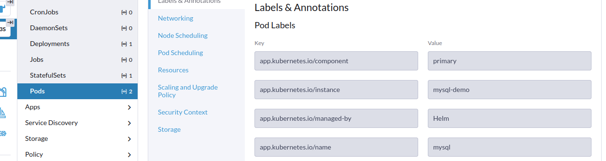

### CoreDNS
**La config du CoreDNS est le ConfigMap coredns**
: `k edit -n kube-system cm coredns`

Logs du coreDNS
~~~
kubectget pods -A
kubectl logs -f -n kube-system coredns-ff8999cc5-zqkwr
~~~

### Commands
**Show Network Policies**    
~~~
kubectl get networkpolicy -A | [-n demo-ns]
~~~

~~~
k describe networkpolicy  demo-helm-egress-mysql -n demo-ns
~~~

**Test Acces**
~~~
kubectl exec -it demo-spring-deployment-6c474ff598-xkw25 -c nettools-sidecar -n demo-ns -- /bin/sh
~~~

**NSlookup**
~~~
nslookup <mysql-service>.<mysql-namespace>.svc.cluster.local
~~~

### iptables
**Afficher les regles NAT iptables**
~~~sh
iptables -L -t nat
~~~

**SNAT/MASQUERADE** : traduction d’adresses `source`

### Flanel, Cilium, Galico
- Flanel, qui en vient par defaut avec k3s, negere pas les NetworkPolicy
- Cilium: semble être largement utilisé dans leCloud(Google, AWS, etc)

### Allow DNS Resolution
Apres mise en place du networkPolicy, tout ce qui n'est parmis est interdit. Donc il faut explicitement autoriser le flux 53/udp/tcp pour la resolution DNS.

Recuperer l'IP du serveur DNS du sluster(CoreDNS)
~~~
kubectl get svc kube-dns -n kube-system
~~~

### Cilium
Cilium est un plugin CNI(Container Network Iterface) pour kubernetes basé sur eBPF. Il permet la gestion reseau des Pods, de gérer les flux entre les pods à l'internieur du cluster, mais aussi avec l'exterieur du cluster.

**Logs du Cilium**

~~~
    kubectl -n kube-system get pods
    k logs -f -n kube-system cilium-xxxxx
~~~

**Debug des flux**

~~~
    kubectl -n kube-system exec -it cilium-xxxx -- bash
    cilium monitor | grep 53
~~~

### Network Plocy
~~~
telnet mysql-demo.mysql.svc.cluster.local 3306
~~~

 

Pour Savoir sur quel Pod appliquer la regle:
 

