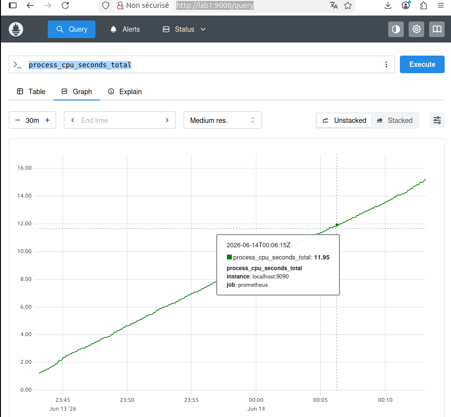
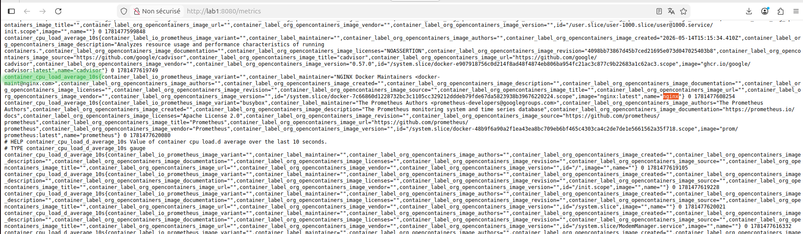
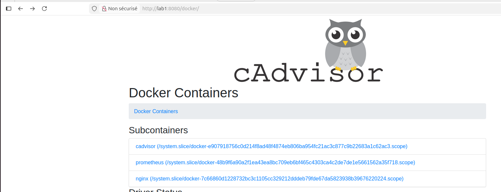

### Metrics Server
- Installer  Metrics Server sur ton cluster

Pour afficher les stats CPU/MEM:
- Par Noeud: `ubectl top node `
- Par Pod et leurs conteneurs: `kubectl top pod --containers=true -A`
- Metrics d'un noeud: `kubectl get --raw "/api/v1/nodes/<node-name>/proxy/stats/summary" | jq '.'`
- Metrics CAdvisor sur un noeud: `kubectl get --raw "/api/v1/nodes/<node-name>/proxy/metrics/cadvisor" | jq '.'`


### Run Prometheus on Docker
- [prometheus.yml](https://github.com/prometheus/prometheus/blob/main/documentation/examples/prometheus.yml)

   Creer la config: `prometheus.yml` 

    ```yaml
    global:
    scrape_interval: 15s  # How often to collect metrics
    evaluation_interval: 15s

    alerting:
    alertmanagers:
        - static_configs:
            - targets:
            # - alertmanager:9093

    rule_files:
    # - "alert_rules.yml"

    scrape_configs:
    - job_name: "prometheus"

        static_configs:
        - targets: ["localhost:9090"]  # Monitor Prometheus itself
    ```

- Creer le repertoire */path/to/prometheus/data/*, c'est dans repertoire que Prometheus va sotcker les metriques, pour eviter qu'ils restent sur le stockage ephemere du conteneur. 

- Acces: `chmod -R 777 /path/to/prometheus/data/`

- Lancer le conteneur prometheus
    ```
    docker run --name=prometheus -d  -p 9000:9090 \
        -v /path/to/prometheus/prometheus.yml:/etc/prometheus/prometheus.yml \
        -v /path/to/prometheus/data:/prometheus  \
        prom/prometheus:latest
    ```

- URL : http://lab1:9000


### Les metricques
- Pour acceder au metrics en temps reel : http://lab1:9000/metrics

  Il sont au format: `clé valeur`
  
  ```
  process_cpu_seconds_total 5.78
  process_network_receive_bytes_total 56114
  process_resident_memory_bytes 9.969664e+07
  ...
  ```

- Pour requeter/afficher des graphes: http://lab1:9000/query

  puis saisir `process_cpu_seconds_total`
  
  
  

### cadviser
cadviser is a running daemon that collects, aggregates, processes, and exports information about running containers. It discovers automaticly all docker running on machine.

**cadviser is included in kubelet**, you don't need to install it(voir en bas). 

**Start the container**

```bash
sudo docker run \
  --volume=/:/rootfs:ro \
  --volume=/var/run:/var/run:ro \
  --volume=/sys:/sys:ro \
  --volume=/var/lib/docker/:/var/lib/docker:ro \
  --volume=/dev/disk/:/dev/disk:ro \
  -p 8080:8080 \
  -d \
  --name=cadvisor \
  --privileged \
  --device=/dev/kmsg \
  ghcr.io/google/cadvisor:latest
```

**Url**: http://lab1:8080/, cadviser expose les metrics sous http://lab1:8080/metrics




**Update your prometheus.yml to scrape cAdvisor**:
```yaml
global:
  scrape_interval: 15s

scrape_configs:
  - job_name: 'prometheus'
    static_configs:
      - targets: ['localhost:9090']

  - job_name: 'docker-containers'
    static_configs:
      - targets: ['lab1:8080']  # cAdvisor exposes container metrics here
```

**Start a container for test, ex nginx** : `docker run -d --name=nginx  -p 8180:80 nginx:latest`, cadviser detect it automaticly see http://lab1:8080/docker/




### Test d'Accès au Metrics cAdviser sur Openshift
!! Il faut creer un Cluster Role et pas un Role puisque NODE n'est pas namespacé

1. Creer un SA : `oc create serviceaccount mysa`
2. Créer un cluster role : `oc create clusterrole my-clusterrole --verb=get,list,watch --resource=nodes/metrics,nodes/stats`
3. Créer ClusterBinding : `oc create clusterrolebinding my-clusterrolebinding --serviceaccount=dev-monitoring:mysa --clusterrole=my-clusterrole`
4. Créer un Token : `oc create token mysa --duration=1h`
5. Test : `curl -k -H "Authorization: Bearer $TOKEN" https://<NODE-IP>:10250/metrics/cadvisor`
6. Test: `oc auth can-i get nodes/metrics --as=system:serviceaccount:dev-monitoring:mysa -A`
 

### Docker Container Metrics

Now Prometheus is scraping cAdvisor, to query metrics via Prometheus UI (http://localhost:9090):

**CPU metrics**

    container_cpu_usage_seconds_total 
    container_cpu_system_seconds_total 
    container_cpu_user_seconds_total 

**Memory metrics**

    container_memory_usage_bytes
    container_memory_max_usage_bytes 
    container_memory_working_set_bytes 

**Network metrics**:

    container_network_receive_bytes_total 
    container_network_transmit_bytes_total
    container_network_receive_errors_total 

**Disk metrics**:

    container_fs_usage_bytes 
    container_fs_limit_bytes 
    container_fs_reads_bytes_total
    container_fs_writes_bytes_total

**To query the cpu usage by a container**
    
    rate(container_cpu_usage_seconds_total{name="container-name"}[5m])

### AlertManager

### Docs
- https://uptrace.dev/tools/prometheus-for-docker
