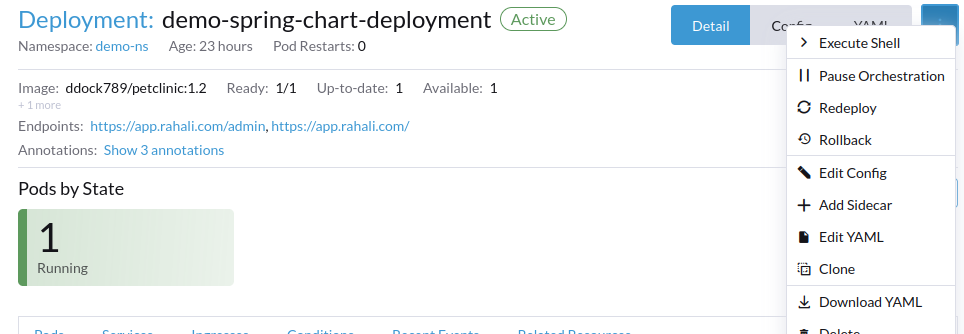
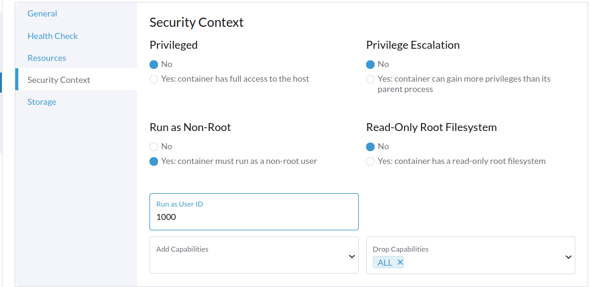

### Ajouter le netdiag sidecar
Cas du PSS- Pod Security Standards est en mode **restricted** sur le namespace.

Depuis Rancher
1. Aller dans Deployment, clique sur les ... et `Add Sidecar`

3. Ajuster `Security Context`: parametres ci-dessous 

4. Edit as YAML: pour ajuster `seccompProfile.type = RuntimeDefault`

~~~
  image: ddock789/netdiag:0.7
    imagePullPolicy: IfNotPresent
    name: netdiag-sidecar
    securityContext:
      runAsNonRoot: true
      readOnlyRootFilesystem: false
      capabilities:
          drop:
          - ALL
      privileged: false
      allowPrivilegeEscalation: false
      runAsUser: 1000
      seccompProfile:
        type: RuntimeDefault
~~~

### Access en Shell sur le sidecar
**Access en shell**
~~~
kubectl -n <ns> exec -it <pod> -c netdiag-sidecar -- bash
~~~

**Faire un curl vers un service local**
~~~sh
curl http://<service>.<namespace>.svc.cluster.local:<port>/health
~~~
