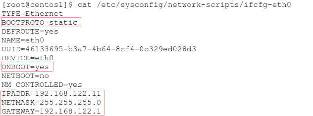
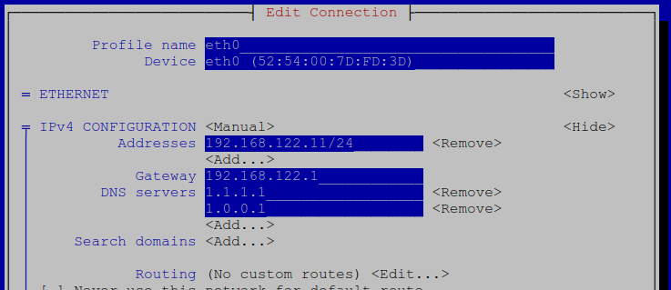
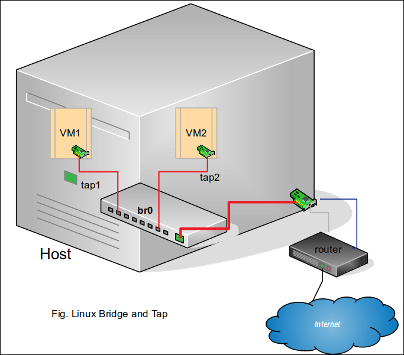

**Env. Ubuntu 20.04, Centos 7**

## Memos
Wich IP is pinging me?

	$ tcpdump -n -i enp0s8 icmp and icmp[icmptype]=icmp-echo

## Iptables
Iptables est un outil userspace pour configuer le module noyau **Netfilter** qui est la base du firewall. 

Iptables maintient ses règles dans des tables:
🔹 1. **filter**

Table par défaut : elle contrôle le filtrage du trafic (firewall).

Chaînes :

- INPUT : trafic entrant vers la machine locale.
- OUTPUT : trafic sortant depuis la machine.
- FORWARD : trafic qui traverse la machine (routage).

📌 Exemple :
~~~
sudo iptables -A INPUT -p tcp --dport 22 -j ACCEPT
~~~

2. **nat** (Network Address Translation)

Sert à modifier les adresses IP ou les ports, souvent pour le port forwarding ou le masquerading.

Chaînes :

- PREROUTING : avant routage (ex : redirection de ports).

- POSTROUTING : après routage (ex : masquerade).

- OUTPUT : pour les connexions locales.

Exemple: rediriger le flux arrivant sur  le port 8080 vers le port local 80
~~~sh
sudo iptables -t nat -A PREROUTING -p tcp --dport 8080 -j REDIRECT --to-port 80
~~~

Pour pouvoir  y acceder depuis localhost, il faut creer une chaine OUTPUT
~~~sh
curl http://localhost:8080

iptables -L -n -t nat
   
sudo iptables -t nat -A OUTPUT -p tcp --dport 8080 -j REDIRECT --to-port 80
~~~

- tables raw,  mangle,security

**Pour autoriser les connexions entrantes sur le port 80**

~~~sh
iptables -I INPUT 1 -p tcp --dport 80 -m state --state NEW -j ACCEP
~~~
- **-I INPUT 1**: là c'est la règle à la tête de la table

**Sauvegarder la configuration**
~~~sh
service iptables save
~~~

**Lister les règles du firewall***
~~~sh
iptables -t filter -L -n
~~~

## Network Manager
### Configure a Static IP
List all net devices: **nmcli**

	$ nmcli d
	
	DEVICE  TYPE      STATE      CONNECTION 
	eth0    ethernet  connected  eth0       
	lo      loopback  unmanaged  --     

* Edit **/etc/sysconfig/network-scripts/ifcfg-eth0** 

* Or use **nmtui**  
	
	$ nmtui

Restart NM

	$ systemctl restart network

## IP
### IP vs Ifconfig
IP is a replacement for ifconfig command. IP command is orginazed on two layers: Link Layer(**ip link**), IP Layer(**ip a**).

Dispalay all NICs   
    
    $ ifconfig                                 
    $ ip a                                        

Add IP address     

    $ ifconfig eth0 add 192.168.43.17          
    $ ip a add 192.168.43.17 dev eth0              

Set MAC            

    $ ifconfig eth0 hw ether ae:09:29:13:43:a3 
    $ ip link set dev eth0 address ae:09:29:13:43:a3

Set MTU            

    $ ifconfig eth0 mtu 1800                   
    $ ip link set dev eth0 mtu 1800                 

Set promiscous     
    
    $ ifconfig eth0 promisc                    
    $ ip link set dev eth0 promisc on               

Enable/Disable NIC 
    
    $ ifconfig eth0 [up down]                  
    $ ip link set eth0 [up dow]                      

### Routing Table
Routing table explained: https://geek-university.com/ccna/routing-table-explained

    # route -n
    Kernel IP routing table
    Destination     Gateway         Genmask         Flags Metric Ref    Use Iface
    0.0.0.0         10.98.56.1      0.0.0.0         UG    100    0        0 enp0s3
    170.56.2.0      10.2.0.1        255.255.255.0   U     100    0        0 enp0s3
    168.254.0.0     0.0.0.0         255.255.0.0     U     1000   0        0 enp0s8

Send to "10.2.0.1"(Gateway) all packets that are destinated to the network 170.56.2.0(from 170.56.2.0 to 
170.56.2.254) by passing by interface enp0s3.

**Default route**: dest=0.0.0.0 and mask=0.0.0.0. route for all packets that don't have a specified route 
in routing table. We use the default route for Internet.

Delete a route:

    # route del default

Add default route

    # route add default gw 10.98.56.1 dev enp0s3

Open connections
	
	netstat -np | grep 8080
	lsof -nPp 2552257 | grep 8080     ; -P : for numerique ports 

### Linux Bridge and Tap

### TCPDUMP

	tcpdump -v -A -s 0  port 8080 and host 192.168.1.1  -w capt.log   
	
### Wireshark
	use Wireshark to read capt.log
	 
	 

 
