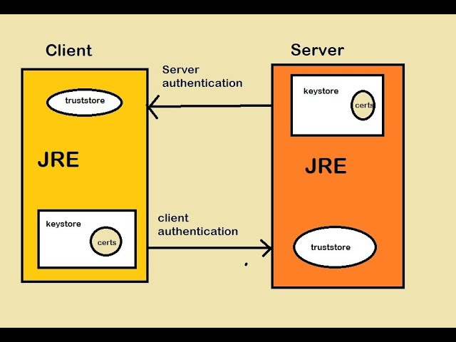

### Java KeyStore
---------------------------------


**Difference between KeyStore and TrustStore**  
  KeyStore contain credentials, TrustStore verify credentials

**Options form Tomcat**
- For trustStore:
```sh
  -Djavax.net.ssl.trustStore=/to/conf/keystores/app.jks 
  -Djavax.net.ssl.trustStorePassword=CHANGE_ME 
  -Djavax.net.ssl.trustStoreType=JKS
```
- For keyStore:
  see SSL connector in server.xml

- Debug SSL
```sh
  -Djavax.net.debug=ssl or -Djavax.net.debug=ssl:handshake or -Djavax.net.debug=all
```

### Keytool
---------------------------------

**Generate a Java keystore and key pair**
```sh
  keytool -genkey -alias myapp-re7 -keyalg RSA -keystore myapp.jks -keysize 2048 
```

**Installing the Self-Signed Certificate on the Client**
```sh
  keytool -importcert -alias myapp -file myapp-server-cert.pem -keystore cacerts -storepass changeit
```


**Importing a root CA-Signed Certificate**
```sh
  keytool -import -trustcacerts -alias myapp -file myapp-cert.pem -keystore cacerts -storepass changeit
```

**Delete a certificate from a Java Keytool keystore**
```sh
  keytool -delete -alias myapp -keystore myapp.jks
```

**Change Alias**
```sh
  keytool -changealias -keystore MY_KEYSTORE_2.jks -alias XXX-XXX -destalias MY_ALIAS
  keytool -changealias -keystore smu.jks -alias lanceur1 -destalias lanceur2
```
**Checking**
```sh
  # Wich  certs are in a jks
  keytool -list -v -keystore keystore.jks
  
  keytool -list -v -keystore myapp.jks
  keytool -delete -alias myapp -keystore myapp.jks
  keytool -importcert -alias myapp -file myapp.cer -keystore myapp.jks
```

#### Transformer une KeyStore to PEM
```
keytool -importkeystore -srckeystore server-keystore.jks -destkeystore tmp.p12 -srcalias prod -srcstoretype jks -deststoretype pkcs12
openssl pkcs12 -in tmp.p12 -out tmp.pem
openssl x509 -in tmp.pem >>tmp_nopassphrase.pem
```

#### Import Cert to TrusrtStore
```
cp /produits/java/jre_1.7.0/lib/security/cacerts prod-truststore.jks
keytool -storepasswd -keystore prod-truststore.jks
keytool -import -trustcacerts -alias prod -file tmp_nopassphrase.pem -keystore prod-truststore.jks -storepass changeit

JAVA_OPTS= "$JAVA_OPTS -Djavax.net.ssl.trustStore=/data/certificats/prod-truststore.jks  -Djavax.net.ssl.trustStorePassword=CHANGE_ME"
```

### Java: Default and supported TLS versions

* Java 8 Update 161 and Later: 

  ** TLS 1.2 is enabled by default. 

* Java 11 and Later: 

** TLS 1.3 is supported, 
** TLS 1.2 remains the default version. 

* Java 7:
** Default: TLS 1.0 and TLS 1.1.
** TLS 1.2 is supported but not enabled by default.

* Java 6:
** Default: SSL 3.0 and TLS 1.0.
** TLS 1.1 and TLS 1.2 are not supported by default.

* Java 5 and Earlier:
** Default: SSL 3.0.
** TLS is not supported.

